# lmgallery

17 scripting hosts, 35 runnable compositions: compute a result, then turn it into a picture.

|  |  |  |
| :---: | :---: | :---: |
| <a href="https://github.com/lmctl-ai/lmplot">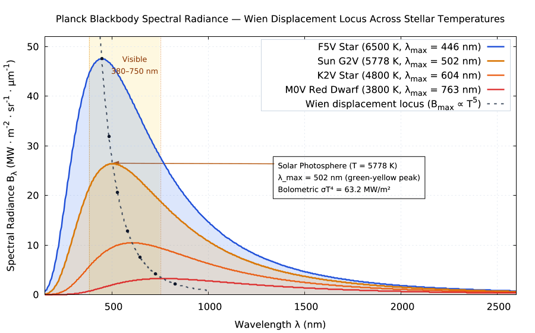</a><br>**lmplot** — Plots and surfaces<br>[repo](https://github.com/lmctl-ai/lmplot) · [releases](https://github.com/lmctl-ai/lmplot/releases) | <a href="https://github.com/lmctl-ai/lmnum">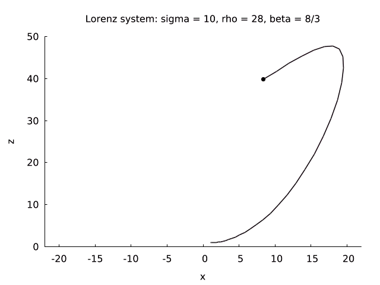</a><br>**lmnum** — Numerical computing<br>[repo](https://github.com/lmctl-ai/lmnum) · [releases](https://github.com/lmctl-ai/lmnum/releases) | <a href="https://github.com/lmctl-ai/lmfinance"></a><br>**lmfinance** — Financial models<br>[repo](https://github.com/lmctl-ai/lmfinance) · [releases](https://github.com/lmctl-ai/lmfinance/releases) |
| <a href="https://github.com/lmctl-ai/lmspace">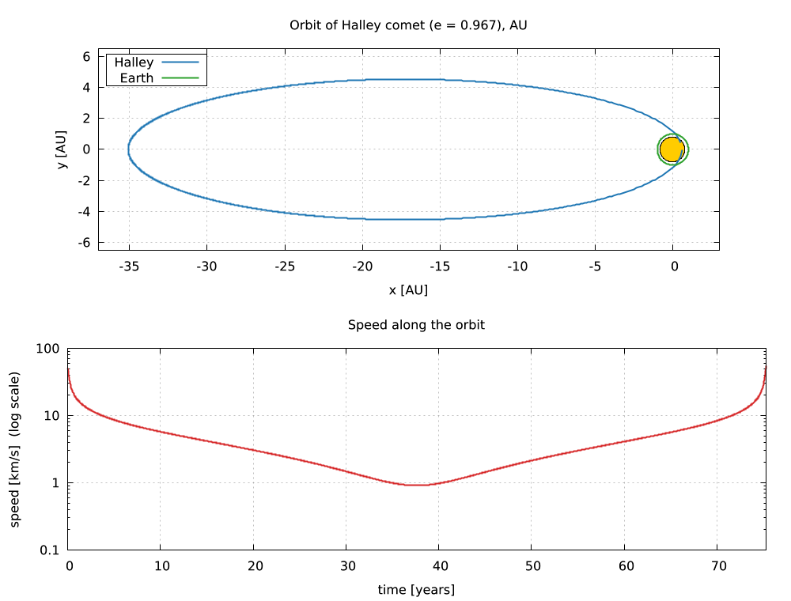</a><br>**lmspace** — Orbital dynamics<br>[repo](https://github.com/lmctl-ai/lmspace) · [releases](https://github.com/lmctl-ai/lmspace/releases) | <a href="https://github.com/lmctl-ai/lmphysics"></a><br>**lmphysics** — Rigid-body mechanics<br>[repo](https://github.com/lmctl-ai/lmphysics) · [releases](https://github.com/lmctl-ai/lmphysics/releases) | <a href="https://github.com/lmctl-ai/lmbio">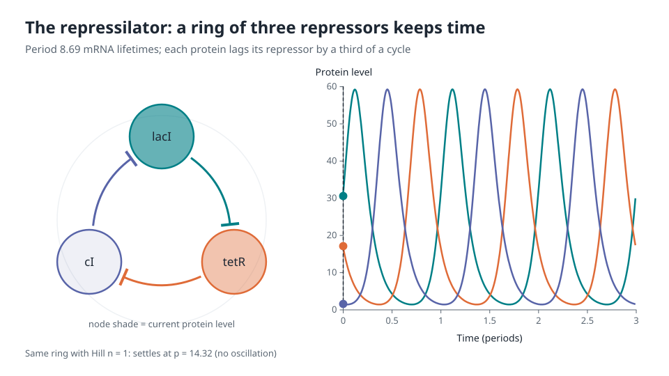</a><br>**lmbio** — Biochemical systems<br>[repo](https://github.com/lmctl-ai/lmbio) · [releases](https://github.com/lmctl-ai/lmbio/releases) |
| <a href="https://github.com/lmctl-ai/lmfluid"></a><br>**lmfluid** — Fluids and finite elements<br>[repo](https://github.com/lmctl-ai/lmfluid) · [releases](https://github.com/lmctl-ai/lmfluid/releases) | <a href="https://github.com/lmctl-ai/lmmolecule">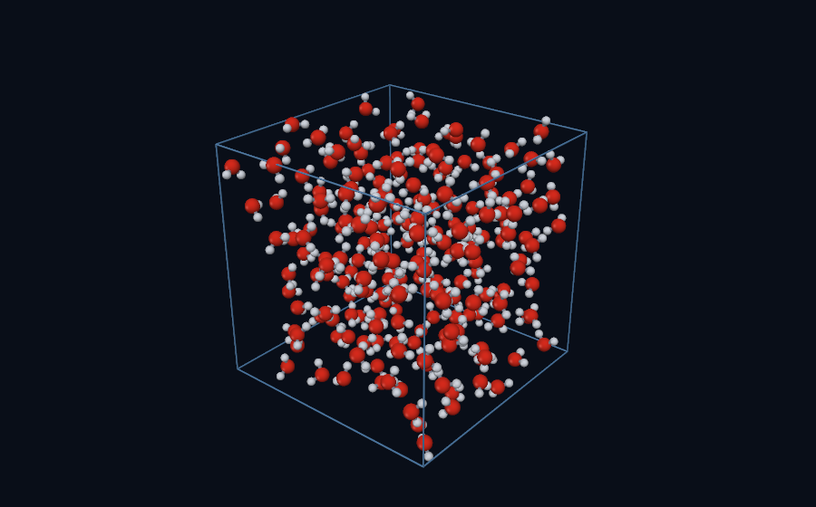</a><br>**lmmolecule** — Molecular simulation<br>[repo](https://github.com/lmctl-ai/lmmolecule) · [releases](https://github.com/lmctl-ai/lmmolecule/releases) | <a href="https://github.com/lmctl-ai/lmcell"></a><br>**lmcell** — Multicellular systems<br>[repo](https://github.com/lmctl-ai/lmcell) · [releases](https://github.com/lmctl-ai/lmcell/releases) |
| <a href="https://github.com/lmctl-ai/lmparticle"></a><br>**lmparticle** — Radiation transport<br>[repo](https://github.com/lmctl-ai/lmparticle) · [releases](https://github.com/lmctl-ai/lmparticle/releases) | <a href="https://github.com/lmctl-ai/lmweather">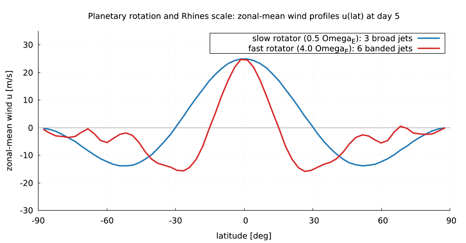</a><br>**lmweather** — Atmospheric dynamics<br>[repo](https://github.com/lmctl-ai/lmweather) · [releases](https://github.com/lmctl-ai/lmweather/releases) | <a href="https://github.com/lmctl-ai/lmdraw"></a><br>**lmdraw** — Annotated 2D drawing<br>[repo](https://github.com/lmctl-ai/lmdraw) · [releases](https://github.com/lmctl-ai/lmdraw/releases) |
| <a href="https://github.com/lmctl-ai/lmcad"></a><br>**lmcad** — Parametric 3D geometry<br>[repo](https://github.com/lmctl-ai/lmcad) · [releases](https://github.com/lmctl-ai/lmcad/releases) | <a href="https://github.com/lmctl-ai/lmblender"></a><br>**lmblender** — Path-traced scenes<br>[repo](https://github.com/lmctl-ai/lmblender) · [releases](https://github.com/lmctl-ai/lmblender/releases) | <a href="https://github.com/lmctl-ai/lmimg">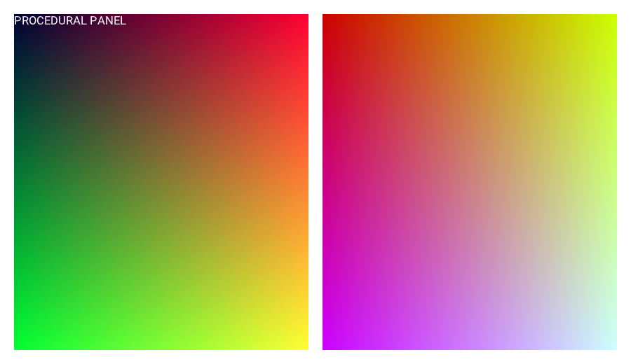</a><br>**lmimg · preview** — Image processing<br>[repo](https://github.com/lmctl-ai/lmimg) · [releases](https://github.com/lmctl-ai/lmimg/releases) |
| <a href="https://github.com/lmctl-ai/lmaudio"></a><br>**lmaudio · preview** — Audio synthesis and analysis<br>[repo](https://github.com/lmctl-ai/lmaudio) · [releases](https://github.com/lmctl-ai/lmaudio/releases) | <a href="https://github.com/lmctl-ai/lmshark"></a><br>**lmshark · preview** — Packet and protocol analysis<br>[repo](https://github.com/lmctl-ai/lmshark) · [releases](https://github.com/lmctl-ai/lmshark/releases) |  |

Click a picture to explore its host. These are copied snapshots, credited in [image attribution](docs/ATTRIBUTION.md).
**Preview** marks first releases with smaller APIs: lmimg, lmaudio, lmshark. Every host ships prebuilt binaries on its releases page; the badge shows the latest tag.

## Hosts at a glance

| Host | Does | Release | Links |
| :--- | :--- | :--- | :--- |
| **[lmplot](https://github.com/lmctl-ai/lmplot)** | Plots and surfaces: Stellar spectra and the visible band | [](https://github.com/lmctl-ai/lmplot/releases) | [repo](https://github.com/lmctl-ai/lmplot) · [examples](https://github.com/lmctl-ai/lmplot/tree/main/examples) · [releases](https://github.com/lmctl-ai/lmplot/releases) |
| **[lmnum](https://github.com/lmctl-ai/lmnum)** | Numerical computing: A Lorenz trajectory, animated | [](https://github.com/lmctl-ai/lmnum/releases) | [repo](https://github.com/lmctl-ai/lmnum) · [examples](https://github.com/lmctl-ai/lmnum/tree/main/examples) · [releases](https://github.com/lmctl-ai/lmnum/releases) |
| **[lmfinance](https://github.com/lmctl-ai/lmfinance)** | Financial models: A Heston implied-volatility surface | [](https://github.com/lmctl-ai/lmfinance/releases) | [repo](https://github.com/lmctl-ai/lmfinance) · [examples](https://github.com/lmctl-ai/lmfinance/tree/main/examples) · [releases](https://github.com/lmctl-ai/lmfinance/releases) |
| **[lmspace](https://github.com/lmctl-ai/lmspace)** | Orbital dynamics: Halley's orbit and changing speed | [](https://github.com/lmctl-ai/lmspace/releases) | [repo](https://github.com/lmctl-ai/lmspace) · [examples](https://github.com/lmctl-ai/lmspace/tree/main/examples) · [releases](https://github.com/lmctl-ai/lmspace/releases) |
| **[lmphysics](https://github.com/lmctl-ai/lmphysics)** | Rigid-body mechanics: A measured force balance on a ramp | [](https://github.com/lmctl-ai/lmphysics/releases) | [repo](https://github.com/lmctl-ai/lmphysics) · [examples](https://github.com/lmctl-ai/lmphysics/tree/main/examples) · [releases](https://github.com/lmctl-ai/lmphysics/releases) |
| **[lmbio](https://github.com/lmctl-ai/lmbio)** | Biochemical systems: Three repressors become a biological clock | [](https://github.com/lmctl-ai/lmbio/releases) | [repo](https://github.com/lmctl-ai/lmbio) · [examples](https://github.com/lmctl-ai/lmbio/tree/main/examples) · [releases](https://github.com/lmctl-ai/lmbio/releases) |
| **[lmfluid](https://github.com/lmctl-ai/lmfluid)** | Fluids and finite elements: A vortex street sheds behind a cylinder | [](https://github.com/lmctl-ai/lmfluid/releases) | [repo](https://github.com/lmctl-ai/lmfluid) · [examples](https://github.com/lmctl-ai/lmfluid/tree/main/examples) · [releases](https://github.com/lmctl-ai/lmfluid/releases) |
| **[lmmolecule](https://github.com/lmctl-ai/lmmolecule)** | Molecular simulation: 216 TIP3P waters, rendered ball-and-stick | [](https://github.com/lmctl-ai/lmmolecule/releases) | [repo](https://github.com/lmctl-ai/lmmolecule) · [examples](https://github.com/lmctl-ai/lmmolecule/tree/main/examples) · [releases](https://github.com/lmctl-ai/lmmolecule/releases) |
| **[lmcell](https://github.com/lmctl-ai/lmcell)** | Multicellular systems: Migration and division close a scratch | [](https://github.com/lmctl-ai/lmcell/releases) | [repo](https://github.com/lmctl-ai/lmcell) · [examples](https://github.com/lmctl-ai/lmcell/tree/main/examples) · [releases](https://github.com/lmctl-ai/lmcell/releases) |
| **[lmparticle](https://github.com/lmctl-ai/lmparticle)** | Radiation transport: Photon attenuation in lead, aluminium and water | [](https://github.com/lmctl-ai/lmparticle/releases) | [repo](https://github.com/lmctl-ai/lmparticle) · [examples](https://github.com/lmctl-ai/lmparticle/tree/main/examples) · [releases](https://github.com/lmctl-ai/lmparticle/releases) |
| **[lmweather](https://github.com/lmctl-ai/lmweather)** | Atmospheric dynamics: Planetary rotation shapes zonal winds | [](https://github.com/lmctl-ai/lmweather/releases) | [repo](https://github.com/lmctl-ai/lmweather) · [examples](https://github.com/lmctl-ai/lmweather/tree/main/examples) · [releases](https://github.com/lmctl-ai/lmweather/releases) |
| **[lmdraw](https://github.com/lmctl-ai/lmdraw)** | Annotated 2D drawing: Real and virtual images through one lens | [](https://github.com/lmctl-ai/lmdraw/releases) | [repo](https://github.com/lmctl-ai/lmdraw) · [examples](https://github.com/lmctl-ai/lmdraw/tree/main/examples) · [releases](https://github.com/lmctl-ai/lmdraw/releases) |
| **[lmcad](https://github.com/lmctl-ai/lmcad)** | Parametric 3D geometry: The carbon cage of a buckyball | [](https://github.com/lmctl-ai/lmcad/releases) | [repo](https://github.com/lmctl-ai/lmcad) · [examples](https://github.com/lmctl-ai/lmcad/tree/main/examples) · [releases](https://github.com/lmctl-ai/lmcad/releases) |
| **[lmblender](https://github.com/lmctl-ai/lmblender)** | Path-traced scenes: Caffeine rendered in atom colours | [](https://github.com/lmctl-ai/lmblender/releases) | [repo](https://github.com/lmctl-ai/lmblender) · [examples](https://github.com/lmctl-ai/lmblender/tree/main/examples) · [releases](https://github.com/lmctl-ai/lmblender/releases) |
| **[lmimg](https://github.com/lmctl-ai/lmimg)** · preview | Image processing: Procedural colour and image transforms | [](https://github.com/lmctl-ai/lmimg/releases) | [repo](https://github.com/lmctl-ai/lmimg) · [examples](https://github.com/lmctl-ai/lmimg/tree/main/examples) · [releases](https://github.com/lmctl-ai/lmimg/releases) |
| **[lmaudio](https://github.com/lmctl-ai/lmaudio)** · preview | Audio synthesis and analysis: Linear and exponential chirp spectrograms | [](https://github.com/lmctl-ai/lmaudio/releases) | [repo](https://github.com/lmctl-ai/lmaudio) · [examples](https://github.com/lmctl-ai/lmaudio/tree/main/examples) · [releases](https://github.com/lmctl-ai/lmaudio/releases) |
| **[lmshark](https://github.com/lmctl-ai/lmshark)** · preview | Packet and protocol analysis: From ARP to HTTP in a packet sequence | [](https://github.com/lmctl-ai/lmshark/releases) | [repo](https://github.com/lmctl-ai/lmshark) · [examples](https://github.com/lmctl-ai/lmshark/tree/main/examples) · [releases](https://github.com/lmctl-ai/lmshark/releases) |

Each host is a separate program with its own `--dsl-schema`; one `.lms` program can bind several of them. The 35 compositions below do exactly that.

## Run a composition

Install the [lmctl runner](https://github.com/lmctl-ai/lmctl), then copy a caption command into an empty directory:

```sh
npm install -g @lmctl-ai/lmctl
lmctl autorun https://raw.githubusercontent.com/lmctl-ai/lmgallery/main/examples/01-oscillator-ode-plot.lms
```

Each program installs its declared hosts on first use, executes every DSL block, and writes its picture to `images/` in the current directory. Data and bytecode are generated locally; no checkout or sibling files are needed. Host downloads require internet access; `GITHUB_TOKEN` can help with GitHub API download limits. Each program prints its output path and stops if computation or rendering fails.

|  |  |
| :---: | :---: |
| <a href="examples/01-oscillator-ode-plot.lms">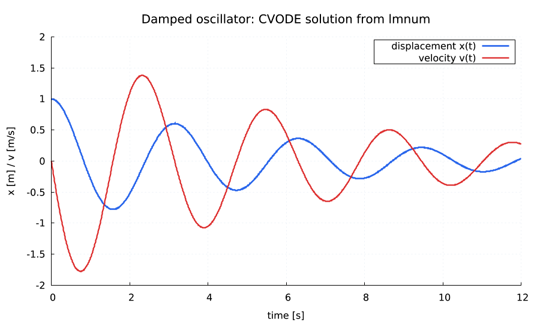</a><br>**Damped oscillator dashboard** · lmnum → lmplot<br><sub><code>lmctl autorun https://raw.githubusercontent.com/lmctl-ai/lmgallery/main/examples/01-oscillator-ode-plot.lms</code></sub> | <a href="examples/02-finance-cashflows-draw.lms">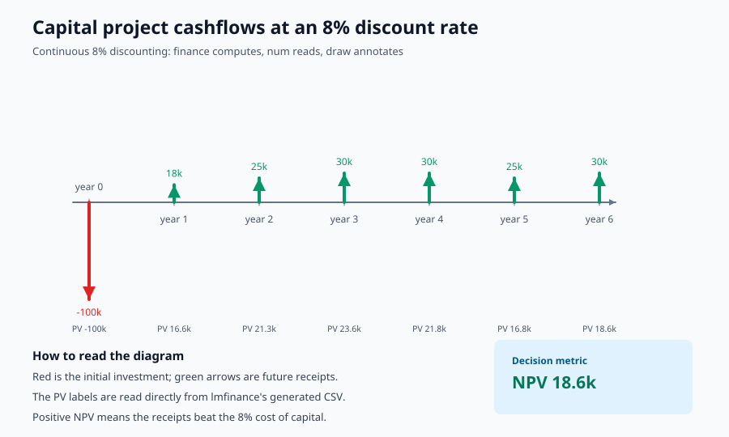</a><br>**Discounted project cashflows** · lmfinance → lmnum → lmdraw<br><sub><code>lmctl autorun https://raw.githubusercontent.com/lmctl-ai/lmgallery/main/examples/02-finance-cashflows-draw.lms</code></sub> |
| <a href="examples/03-weather-pulse-plot.lms">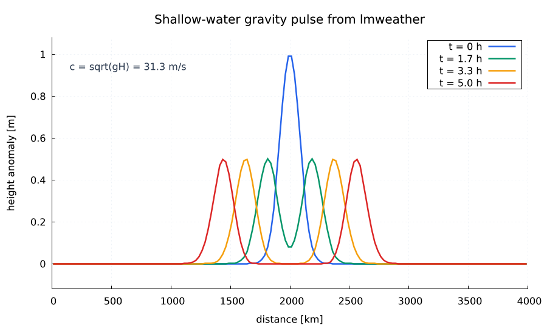</a><br>**Shallow-water gravity pulse** · lmweather → lmplot<br><sub><code>lmctl autorun https://raw.githubusercontent.com/lmctl-ai/lmgallery/main/examples/03-weather-pulse-plot.lms</code></sub> | <a href="examples/04-space-orbit-cad.lms">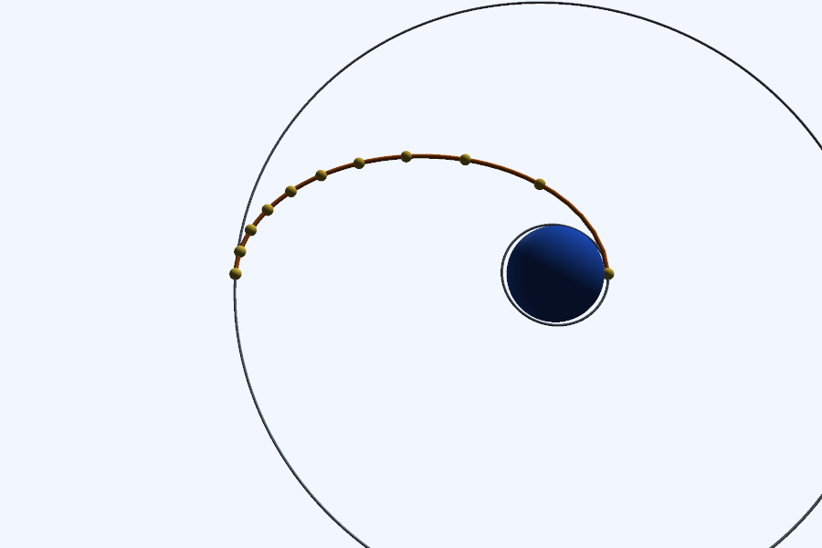</a><br>**Hohmann transfer: equal-time markers** · lmspace → lmcad<br><sub><code>lmctl autorun https://raw.githubusercontent.com/lmctl-ai/lmgallery/main/examples/04-space-orbit-cad.lms</code></sub> |
| <a href="examples/05-physics-free-body.lms">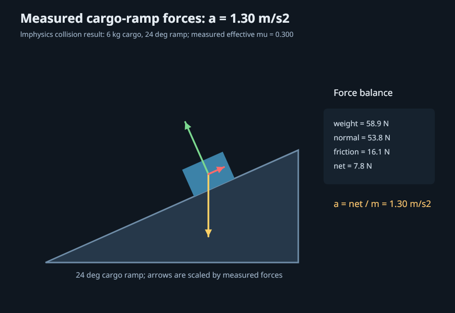</a><br>**Cargo-ramp force balance** · lmphysics → lmdraw<br><sub><code>lmctl autorun https://raw.githubusercontent.com/lmctl-ai/lmgallery/main/examples/05-physics-free-body.lms</code></sub> | <a href="examples/06-fluid-poisson-plot.lms">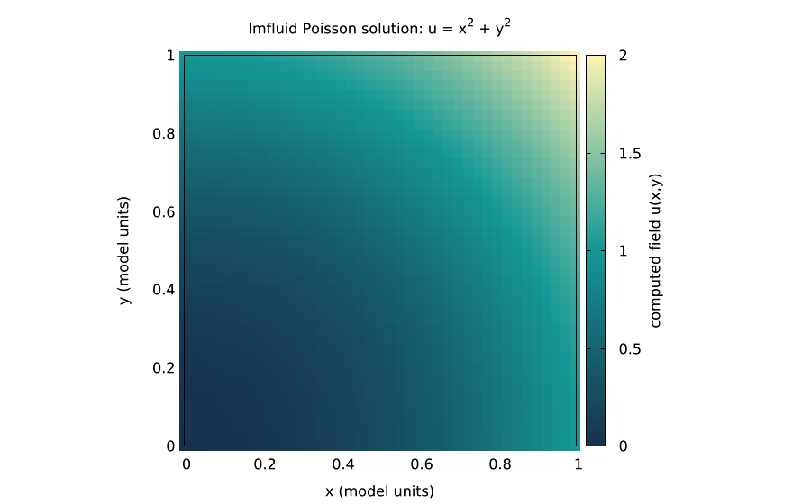</a><br>**Finite-element Poisson field** · lmfluid → lmplot<br><sub><code>lmctl autorun https://raw.githubusercontent.com/lmctl-ai/lmgallery/main/examples/06-fluid-poisson-plot.lms</code></sub> |
| <a href="examples/07-enzyme-response.lms">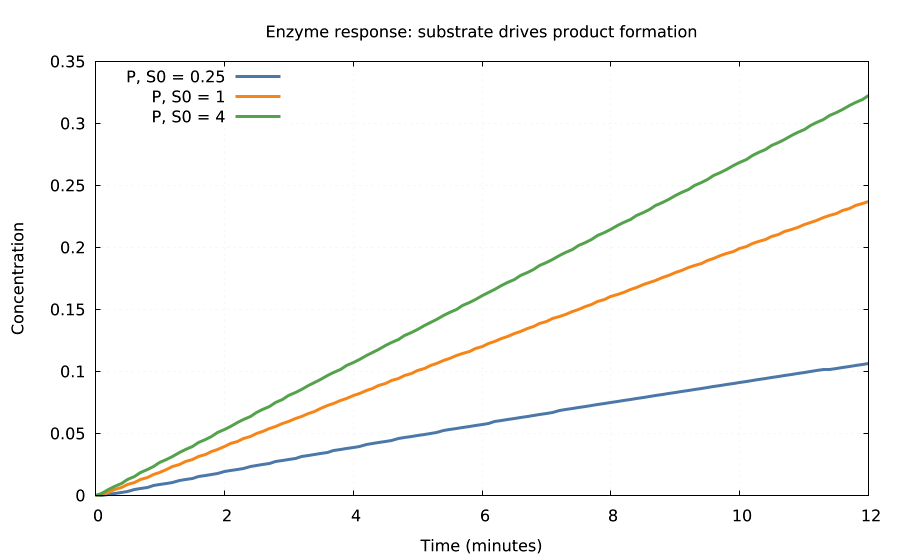</a><br>**Michaelis-Menten from mechanism** · lmbio → lmplot<br><sub><code>lmctl autorun https://raw.githubusercontent.com/lmctl-ai/lmgallery/main/examples/07-enzyme-response.lms</code></sub> | <a href="examples/08-cell-pattern.lms">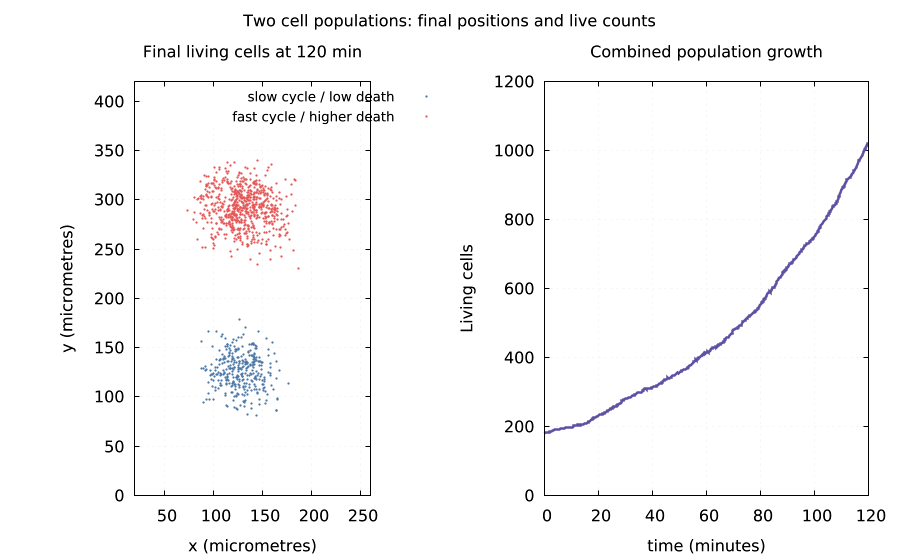</a><br>**Cell growth and motility** · lmcell → lmplot<br><sub><code>lmctl autorun https://raw.githubusercontent.com/lmctl-ai/lmgallery/main/examples/08-cell-pattern.lms</code></sub> |
| <a href="examples/09-photon-transport.lms">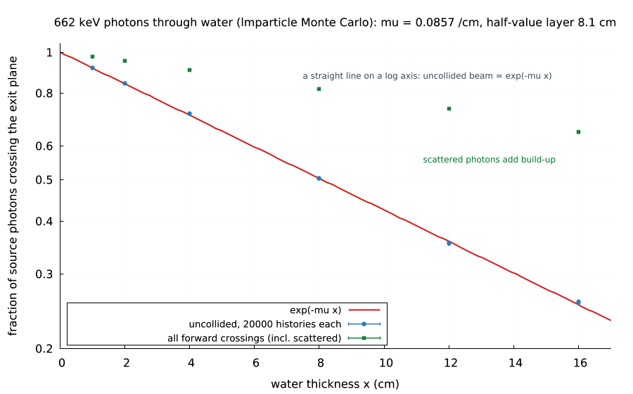</a><br>**Photon attenuation and build-up in water** · lmparticle → lmplot<br><sub><code>lmctl autorun https://raw.githubusercontent.com/lmctl-ai/lmgallery/main/examples/09-photon-transport.lms</code></sub> | <a href="examples/10-molecule-dimer-cad.lms">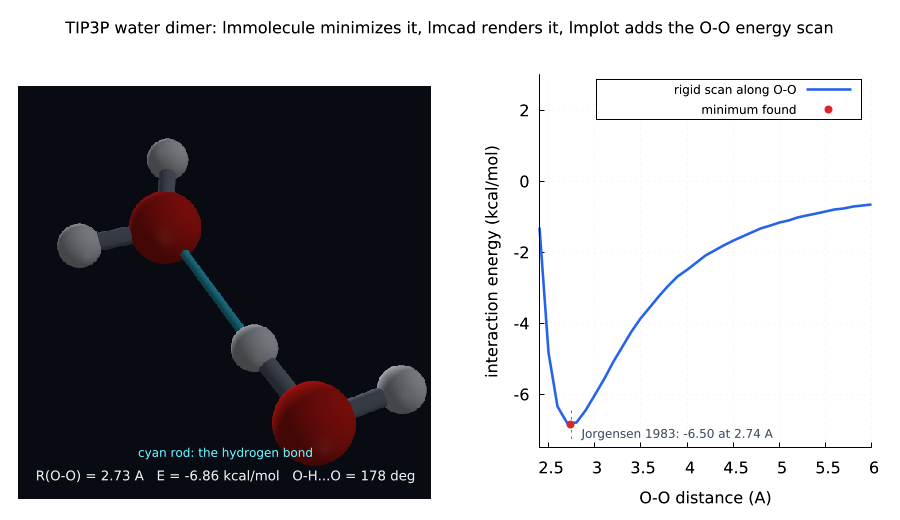</a><br>**Water dimer: hydrogen bond in 3D** · lmmolecule → lmcad → lmplot<br><sub><code>lmctl autorun https://raw.githubusercontent.com/lmctl-ai/lmgallery/main/examples/10-molecule-dimer-cad.lms</code></sub> |
| <a href="examples/11-particle-shield-layout.lms">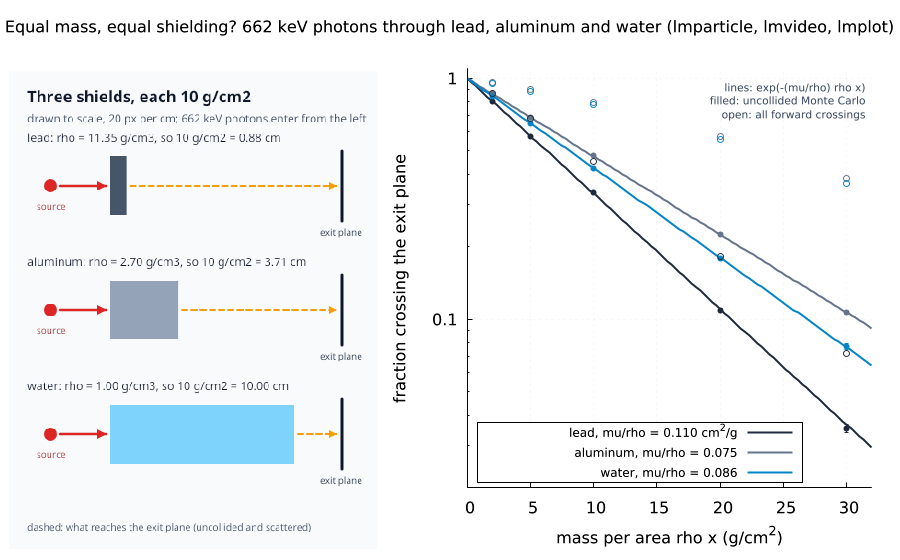</a><br>**Shielding by mass: lead, aluminum, water** · lmparticle → lmdraw → lmplot<br><sub><code>lmctl autorun https://raw.githubusercontent.com/lmctl-ai/lmgallery/main/examples/11-particle-shield-layout.lms</code></sub> | <a href="examples/12-weather-adjustment-gif.lms">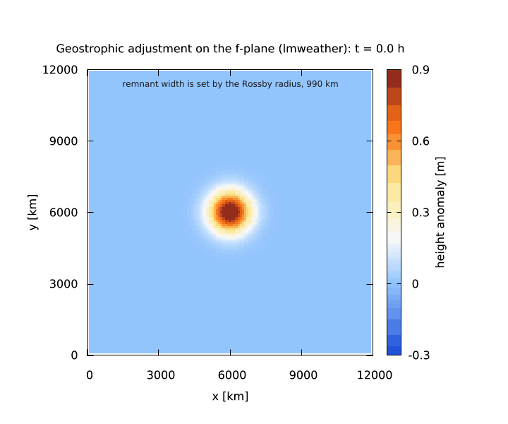</a><br>**Geostrophic adjustment, animated** · lmweather → lmplot<br><sub><code>lmctl autorun https://raw.githubusercontent.com/lmctl-ai/lmgallery/main/examples/12-weather-adjustment-gif.lms</code></sub> |
| <a href="examples/13-bio-dosing-regimen.lms">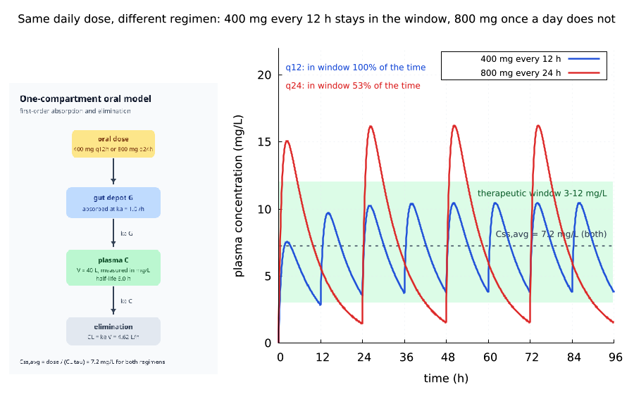</a><br>**Dosing regimen inside a therapeutic window** · lmbio → lmdraw → lmplot<br><sub><code>lmctl autorun https://raw.githubusercontent.com/lmctl-ai/lmgallery/main/examples/13-bio-dosing-regimen.lms</code></sub> | <a href="examples/14-num-sweep-contact-sheet.lms">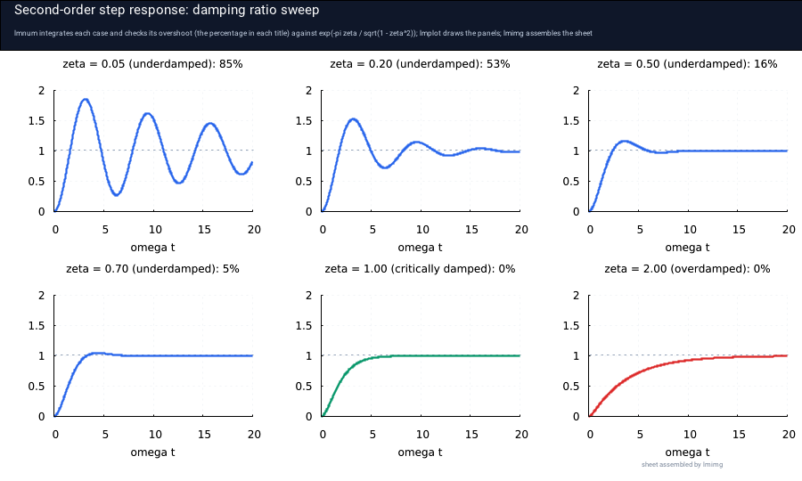</a><br>**Damping-ratio sweep as a contact sheet** · lmnum → lmplot → lmimg<br><sub><code>lmctl autorun https://raw.githubusercontent.com/lmctl-ai/lmgallery/main/examples/14-num-sweep-contact-sheet.lms</code></sub> |
| <a href="examples/15-audio-eq-measurement.lms">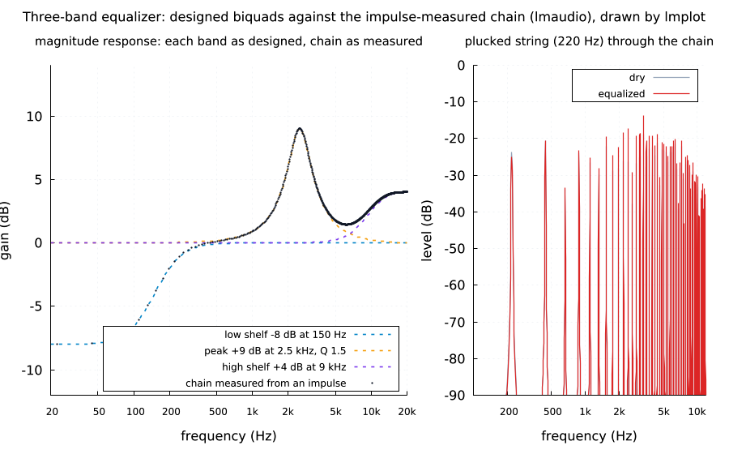</a><br>**Equalizer: designed versus measured** · lmaudio → lmplot<br><sub><code>lmctl autorun https://raw.githubusercontent.com/lmctl-ai/lmgallery/main/examples/15-audio-eq-measurement.lms</code></sub> | <a href="examples/16-kepler-conservation.lms">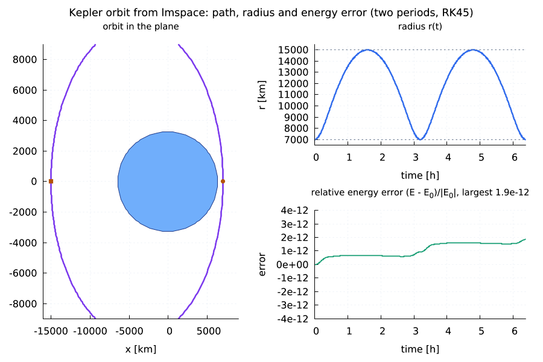</a><br>**Kepler orbit energy check** · lmspace → lmplot<br><sub><code>lmctl autorun https://raw.githubusercontent.com/lmctl-ai/lmgallery/main/examples/16-kepler-conservation.lms</code></sub> |
| <a href="examples/17-oscillator-driven-transient.lms">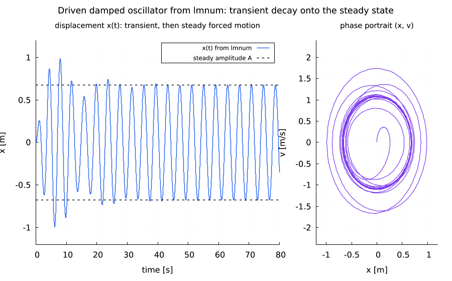</a><br>**Driven oscillator: transient to steady state** · lmnum → lmplot<br><sub><code>lmctl autorun https://raw.githubusercontent.com/lmctl-ai/lmgallery/main/examples/17-oscillator-driven-transient.lms</code></sub> | <a href="examples/18-rigid-body-intermediate-axis.lms">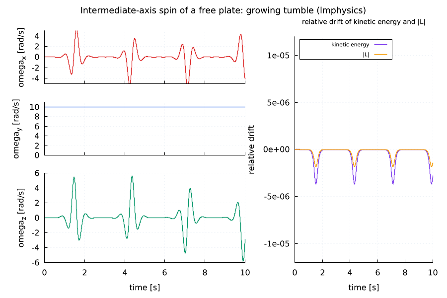</a><br>**Intermediate-axis tumble of a free plate** · lmphysics → lmplot<br><sub><code>lmctl autorun https://raw.githubusercontent.com/lmctl-ai/lmgallery/main/examples/18-rigid-body-intermediate-axis.lms</code></sub> |
| <a href="examples/19-fem-poisson-error.lms">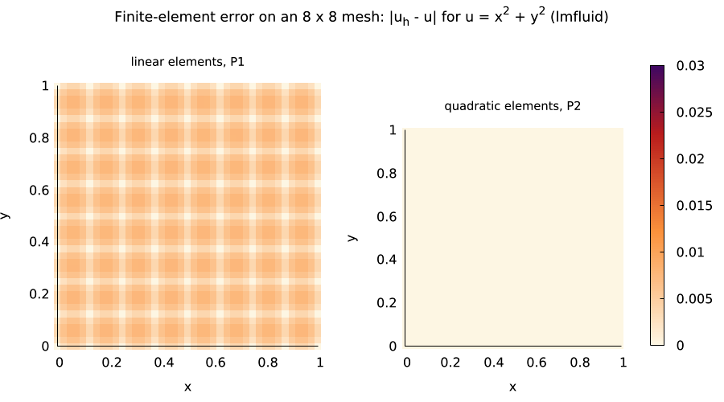</a><br>**Finite-element error against a known answer** · lmfluid → lmplot<br><sub><code>lmctl autorun https://raw.githubusercontent.com/lmctl-ai/lmgallery/main/examples/19-fem-poisson-error.lms</code></sub> | <a href="examples/20-heat-spacetime.lms">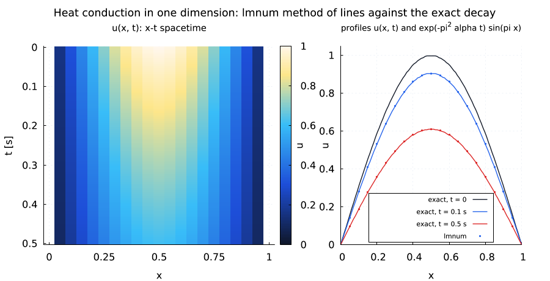</a><br>**Heat conduction in x and t** · lmnum → lmplot<br><sub><code>lmctl autorun https://raw.githubusercontent.com/lmctl-ai/lmgallery/main/examples/20-heat-spacetime.lms</code></sub> |
| <a href="examples/21-forecast-prediction-band.lms">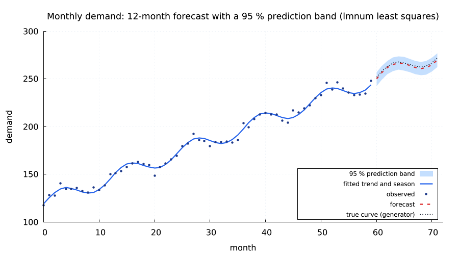</a><br>**Forecast with a 95 % prediction band** · lmnum → lmplot<br><sub><code>lmctl autorun https://raw.githubusercontent.com/lmctl-ai/lmgallery/main/examples/21-forecast-prediction-band.lms</code></sub> | <a href="examples/22-seasonal-decomposition.lms">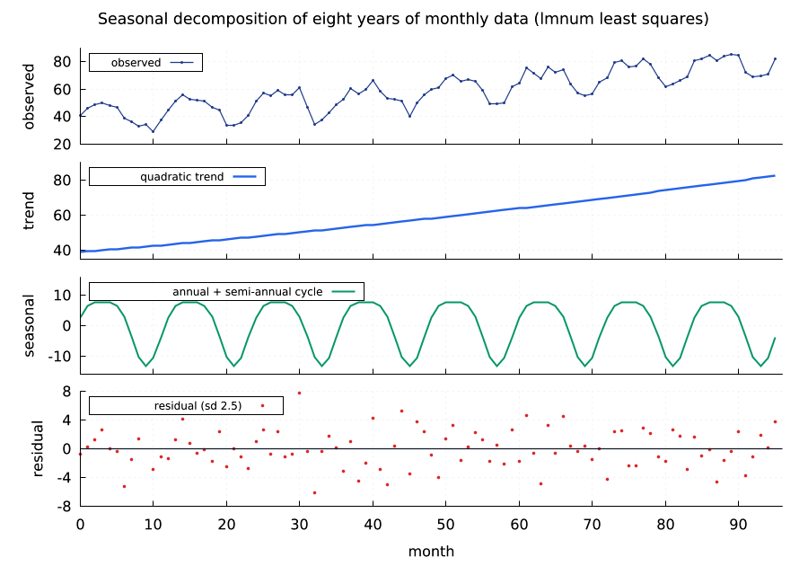</a><br>**Seasonal decomposition by least squares** · lmnum → lmplot<br><sub><code>lmctl autorun https://raw.githubusercontent.com/lmctl-ai/lmgallery/main/examples/22-seasonal-decomposition.lms</code></sub> |
| <a href="examples/23-regression-residuals.lms">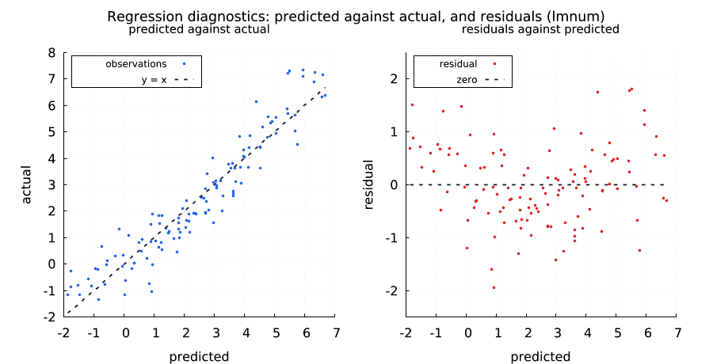</a><br>**Regression diagnostics: predicted, actual and residuals** · lmnum → lmplot<br><sub><code>lmctl autorun https://raw.githubusercontent.com/lmctl-ai/lmgallery/main/examples/23-regression-residuals.lms</code></sub> | <a href="examples/24-signups-date-axis.lms">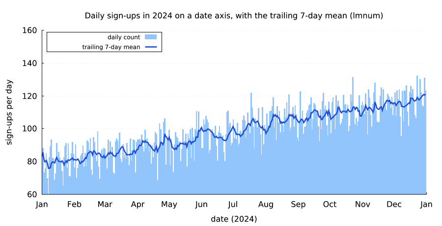</a><br>**Daily sign-ups on a date axis** · lmnum → lmplot<br><sub><code>lmctl autorun https://raw.githubusercontent.com/lmctl-ai/lmgallery/main/examples/24-signups-date-axis.lms</code></sub> |
| <a href="examples/25-queue-erlang-c.lms">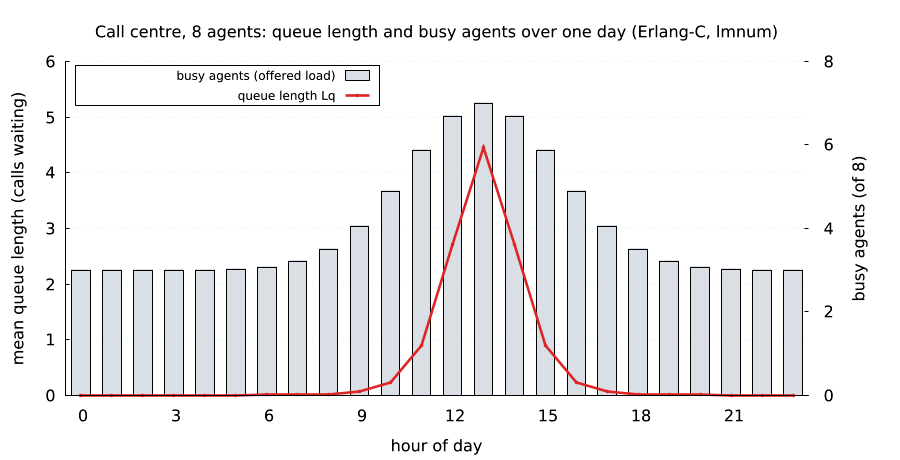</a><br>**Call-centre queue over one day** · lmnum → lmplot<br><sub><code>lmctl autorun https://raw.githubusercontent.com/lmctl-ai/lmgallery/main/examples/25-queue-erlang-c.lms</code></sub> | <a href="examples/26-qbr-deck-charts.lms">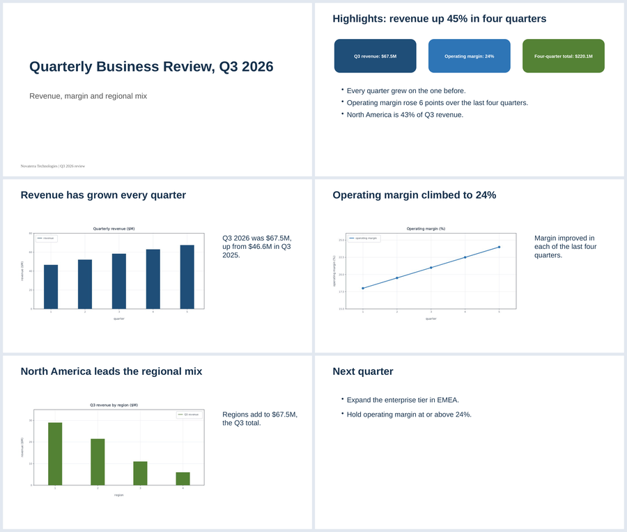</a><br>**Quarterly business review deck with lmvideo charts** · lmvideo → lmoffice<br><sub><code>lmctl autorun https://raw.githubusercontent.com/lmctl-ai/lmgallery/main/examples/26-qbr-deck-charts.lms</code></sub> |
| <a href="examples/27-sales-report-docx.lms">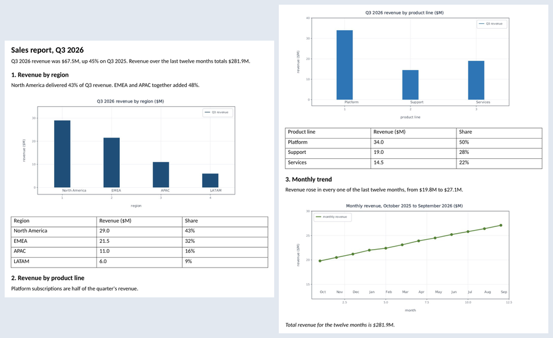</a><br>**Sales report with a chart per section** · lmvideo → lmoffice<br><sub><code>lmctl autorun https://raw.githubusercontent.com/lmctl-ai/lmgallery/main/examples/27-sales-report-docx.lms</code></sub> | <a href="examples/28-forecast-workbook-chart.lms">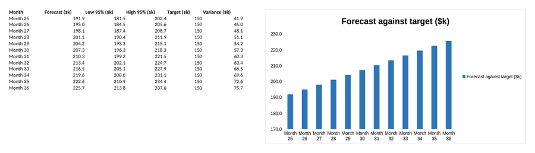</a><br>**Forecast workbook with a native chart** · lmnum → lmvideo → lmoffice<br><sub><code>lmctl autorun https://raw.githubusercontent.com/lmctl-ai/lmgallery/main/examples/28-forecast-workbook-chart.lms</code></sub> |
| <a href="examples/29-invoice-logo-glyph.lms">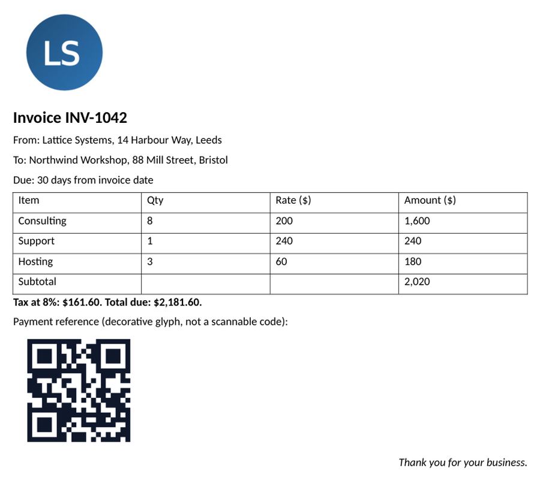</a><br>**Invoice with a generated logo and payment glyph** · lmvideo → lmoffice<br><sub><code>lmctl autorun https://raw.githubusercontent.com/lmctl-ai/lmgallery/main/examples/29-invoice-logo-glyph.lms</code></sub> | <a href="examples/30-resume-skills-bars.lms"></a><br>**Resume with a skills bar chart** · lmvideo → lmoffice<br><sub><code>lmctl autorun https://raw.githubusercontent.com/lmctl-ai/lmgallery/main/examples/30-resume-skills-bars.lms</code></sub> |
| <a href="examples/31-science-report-damping.lms">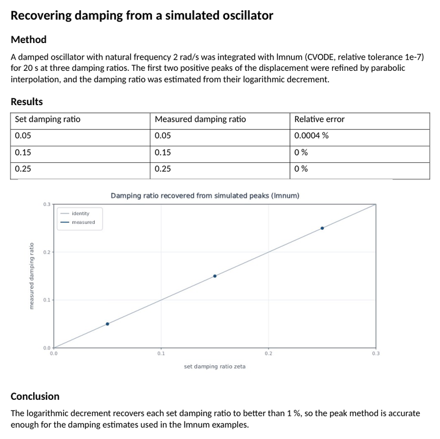</a><br>**Science report: damping recovered from simulated peaks** · lmnum → lmvideo → lmoffice<br><sub><code>lmctl autorun https://raw.githubusercontent.com/lmctl-ai/lmgallery/main/examples/31-science-report-damping.lms</code></sub> | <a href="examples/32-revenue-bars-currency.lms">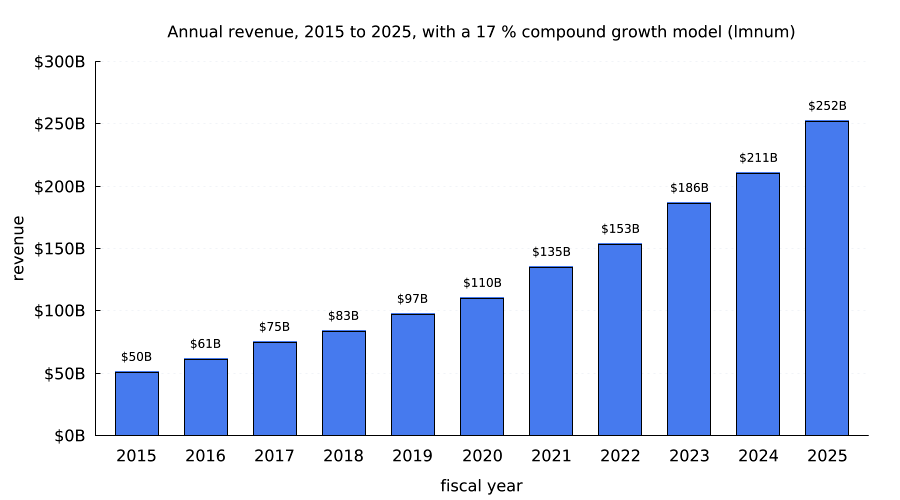</a><br>**Annual revenue bars with currency ticks** · lmnum → lmplot<br><sub><code>lmctl autorun https://raw.githubusercontent.com/lmctl-ai/lmgallery/main/examples/32-revenue-bars-currency.lms</code></sub> |
| <a href="examples/33-wave-2d-animation.lms">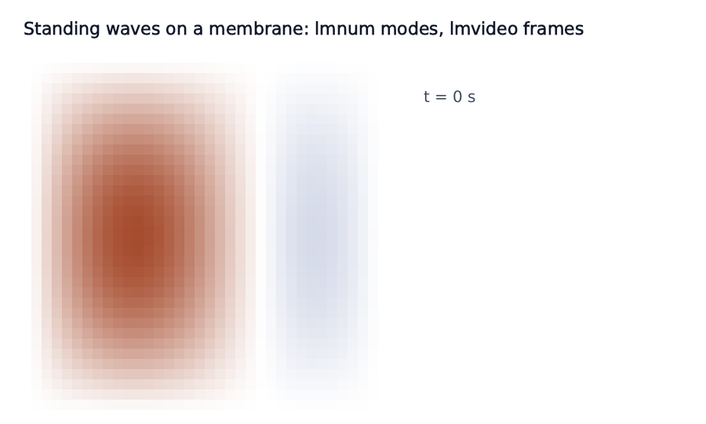</a><br>**Standing waves on a membrane, animated** · lmnum → lmvideo<br><sub><code>lmctl autorun https://raw.githubusercontent.com/lmctl-ai/lmgallery/main/examples/33-wave-2d-animation.lms</code></sub> | <a href="examples/34-image-pipeline-contact-sheet.lms">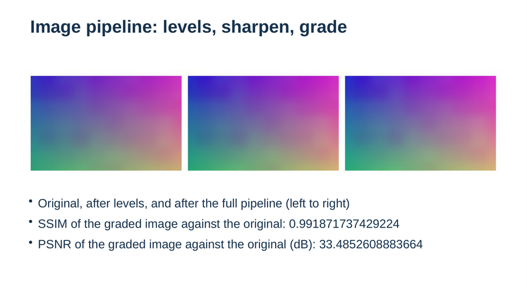</a><br>**Image pipeline with a before/after contact sheet** · lmimg → lmoffice<br><sub><code>lmctl autorun https://raw.githubusercontent.com/lmctl-ai/lmgallery/main/examples/34-image-pipeline-contact-sheet.lms</code></sub> |
| <a href="examples/35-finance-curve-option-workbook.lms">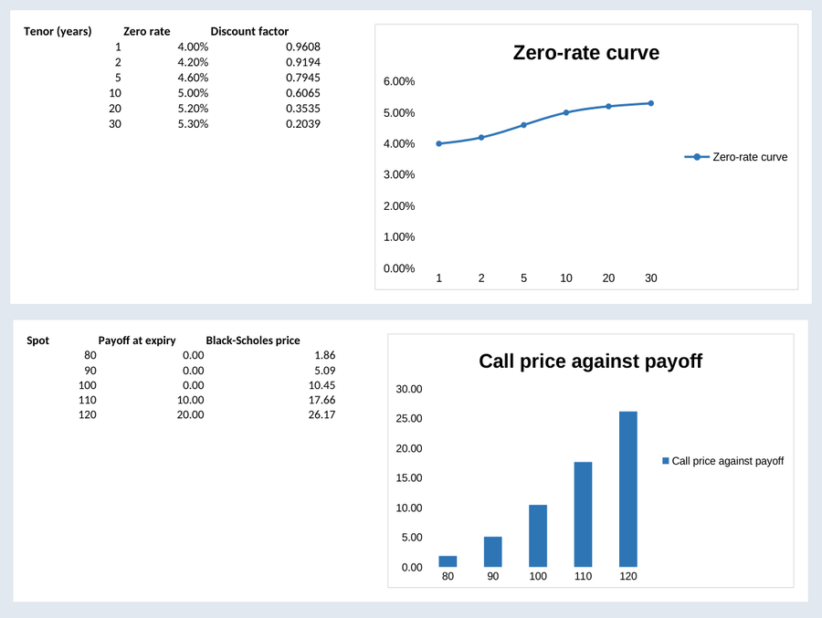</a><br>**Rates and options desk pack: curve, option table and memo** · lmfinance → lmvideo → lmoffice<br><sub><code>lmctl autorun https://raw.githubusercontent.com/lmctl-ai/lmgallery/main/examples/35-finance-curve-option-workbook.lms</code></sub> |  |

The [example index](examples/README.md) describes the data passed between hosts. These are illustrative scientific and engineering models, with assumptions stated in the scripts.

## Reproduce and check

```sh
./test.sh                 # offline image integrity, attribution, manifests and local links
./test.sh --network       # also check published HTTP links; planned hosts are reported explicitly
./test.sh --run           # execute all 35 local scripts, each in a fresh directory
./test.sh --urls          # execute the 35 public autorun URLs in fresh directories
./examples/render-all.sh  # regenerate the 35 composition previews
```

The offline checks need only Python 3.10+. Executable checks additionally need lmctl/lmscript, released hosts (downloaded automatically), `ffmpeg` for the animated composition, and network access on a cold install. CI runs offline/link checks, verifies that every caption's raw URL exists on `main`, and executes all 35 scripts on Linux. Work directories and logs from executable checks are retained outside the checkout for inspection.

Host previews are exact copies recorded in `catalog.json`; composition previews are generated by the programs listed in `showcases.json`. To update documentation after changing either manifest, run `python3 scripts/build-readme.py`. See [maintenance notes](durable-memory/README.md).

## License

MIT for this gallery and its scripts; see [LICENSE](LICENSE). Copied artwork and its generating examples are credited in [ATTRIBUTION](docs/ATTRIBUTION.md), with the retained [upstream MIT notice](licenses/upstream-examples-MIT.txt). Host executables remain separate programs under their own licenses. In particular, lmblender's executable is GPL-3.0-or-later; this repository redistributes its rendered preview, not the renderer or its libraries.
