# Cross-host compositions

Every command runs from an empty directory and writes the listed image. Each computation is passed to a separate rendering host through generated data.

| | |
| :---: | :---: |
| <a href="#damped-oscillator-dashboard"></a><br>Damped oscillator dashboard | <a href="#discounted-project-cashflows"></a><br>Discounted project cashflows |
| <a href="#shallow-water-gravity-pulse"></a><br>Shallow-water gravity pulse | <a href="#hohmann-transfer-equal-time-markers"></a><br>Hohmann transfer: equal-time markers |
| <a href="#cargo-ramp-force-balance"></a><br>Cargo-ramp force balance | <a href="#finite-element-poisson-field"></a><br>Finite-element Poisson field |
| <a href="#michaelis-menten-from-mechanism"></a><br>Michaelis-Menten from mechanism | <a href="#cell-growth-and-motility"></a><br>Cell growth and motility |
| <a href="#photon-attenuation-and-build-up-in-water"></a><br>Photon attenuation and build-up in water | <a href="#water-dimer-hydrogen-bond-in-3d"></a><br>Water dimer: hydrogen bond in 3D |
| <a href="#shielding-by-mass-lead-aluminum-water"></a><br>Shielding by mass: lead, aluminum, water | <a href="#geostrophic-adjustment-animated"></a><br>Geostrophic adjustment, animated |
| <a href="#dosing-regimen-inside-a-therapeutic-window"></a><br>Dosing regimen inside a therapeutic window | <a href="#damping-ratio-sweep-as-a-contact-sheet"></a><br>Damping-ratio sweep as a contact sheet |
| <a href="#equalizer-designed-versus-measured"></a><br>Equalizer: designed versus measured | <a href="#kepler-orbit-energy-check"></a><br>Kepler orbit energy check |
| <a href="#driven-oscillator-transient-to-steady-state"></a><br>Driven oscillator: transient to steady state | <a href="#intermediate-axis-tumble-of-a-free-plate"></a><br>Intermediate-axis tumble of a free plate |
| <a href="#finite-element-error-against-a-known-answer"></a><br>Finite-element error against a known answer | <a href="#heat-conduction-in-x-and-t"></a><br>Heat conduction in x and t |
| <a href="#forecast-with-a-95-%-prediction-band"></a><br>Forecast with a 95 % prediction band | <a href="#seasonal-decomposition-by-least-squares"></a><br>Seasonal decomposition by least squares |
| <a href="#regression-diagnostics-predicted-actual-and-residuals"></a><br>Regression diagnostics: predicted, actual and residuals | <a href="#daily-sign-ups-on-a-date-axis"></a><br>Daily sign-ups on a date axis |
| <a href="#call-centre-queue-over-one-day"></a><br>Call-centre queue over one day | <a href="#quarterly-business-review-deck-with-lmvideo-charts"></a><br>Quarterly business review deck with lmvideo charts |
| <a href="#sales-report-with-a-chart-per-section"></a><br>Sales report with a chart per section | <a href="#forecast-workbook-with-a-native-chart"></a><br>Forecast workbook with a native chart |
| <a href="#invoice-with-a-generated-logo-and-payment-glyph"></a><br>Invoice with a generated logo and payment glyph | <a href="#resume-with-a-skills-bar-chart"></a><br>Resume with a skills bar chart |
| <a href="#science-report-damping-recovered-from-simulated-peaks"></a><br>Science report: damping recovered from simulated peaks | <a href="#annual-revenue-bars-with-currency-ticks"></a><br>Annual revenue bars with currency ticks |
| <a href="#standing-waves-on-a-membrane-animated"></a><br>Standing waves on a membrane, animated | <a href="#image-pipeline-with-a-before/after-contact-sheet"></a><br>Image pipeline with a before/after contact sheet |
| <a href="#rates-and-options-desk-pack-curve-option-table-and-memo"></a><br>Rates and options desk pack: curve, option table and memo | <a href="#html-link-check-report-with-a-terminal-picture">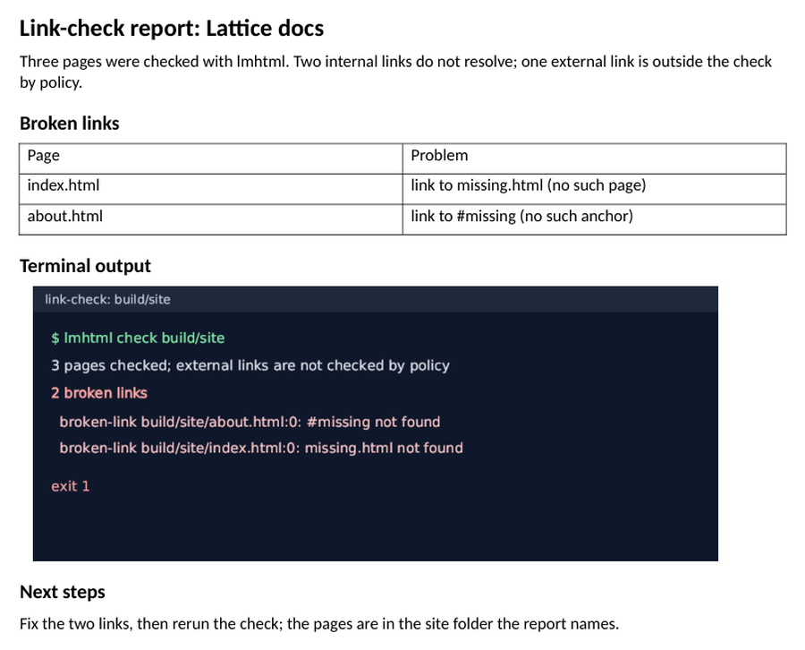</a><br>HTML link-check report with a terminal picture |
| <a href="#certificate-inventory-from-lmssl">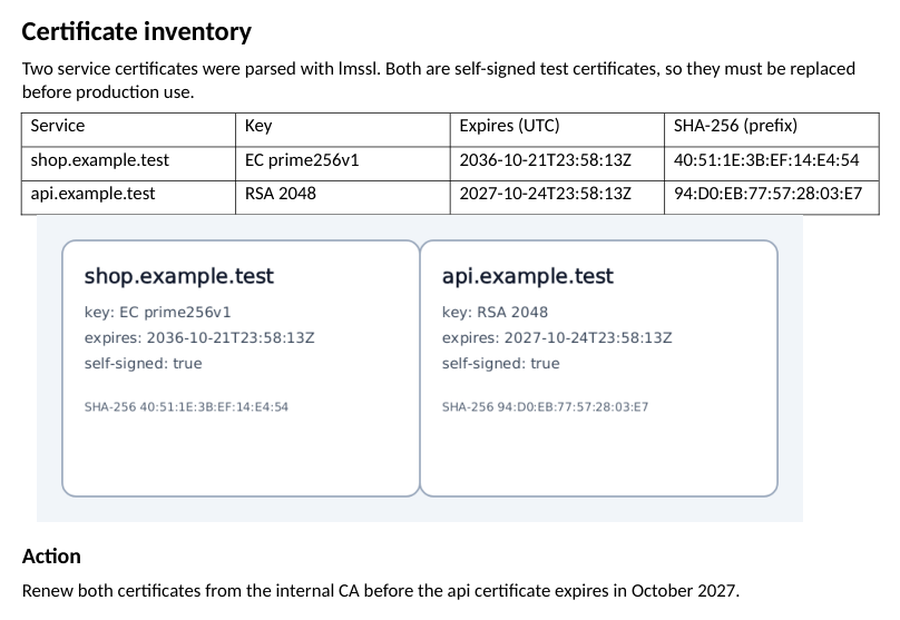</a><br>Certificate inventory from lmssl | <a href="#product-slide-with-an-lmvideo-3d-render">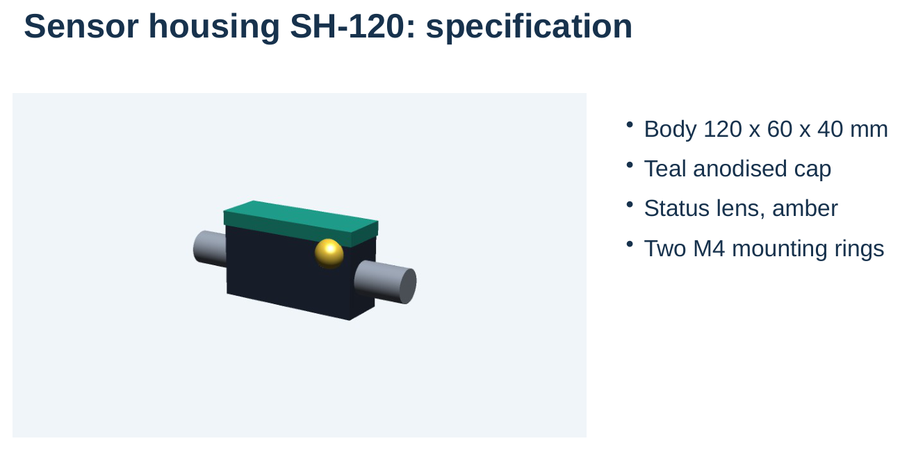</a><br>Product slide with an lmvideo 3D render |
| <a href="#audio-harmonics-slide-with-a-wav-file">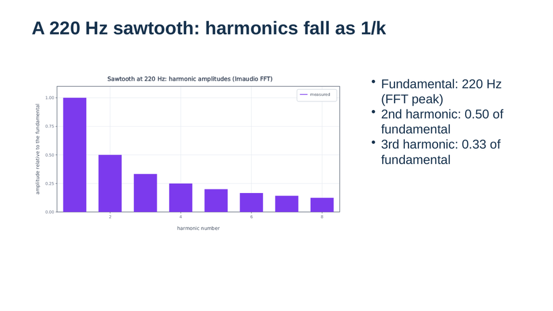</a><br>Audio harmonics slide with a WAV file | <a href="#predator-prey-lab-report-with-an-lmvideo-figure">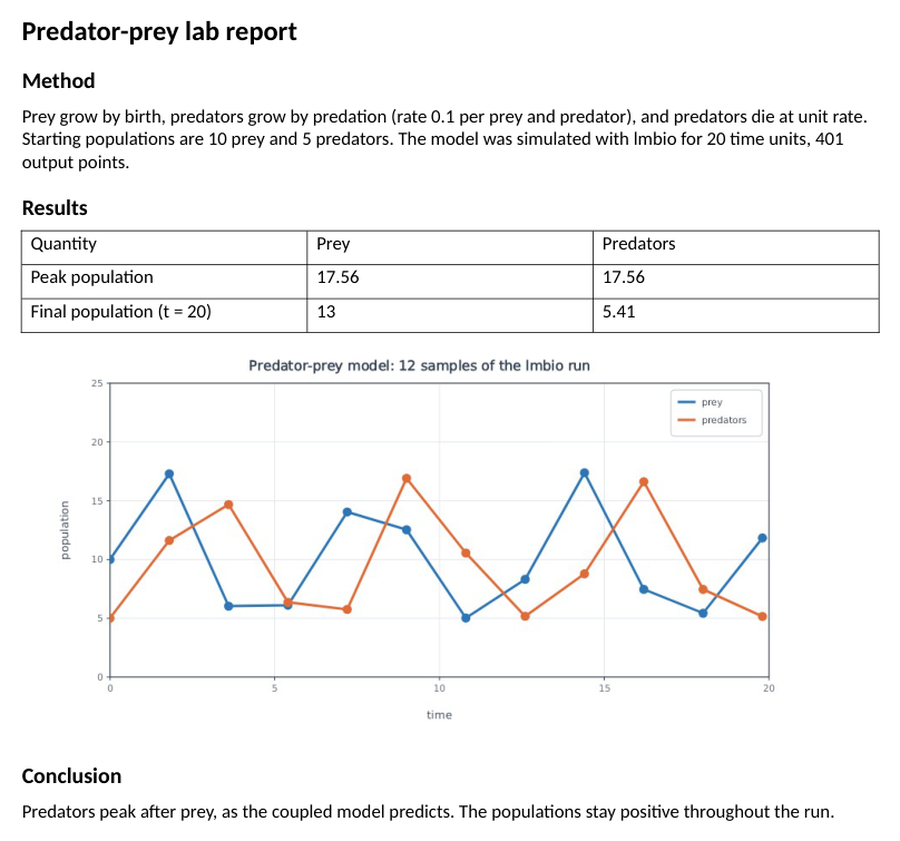</a><br>Predator-prey lab report with an lmvideo figure |
| <a href="#gravity-wave-speed-from-a-shallow-water-pulse">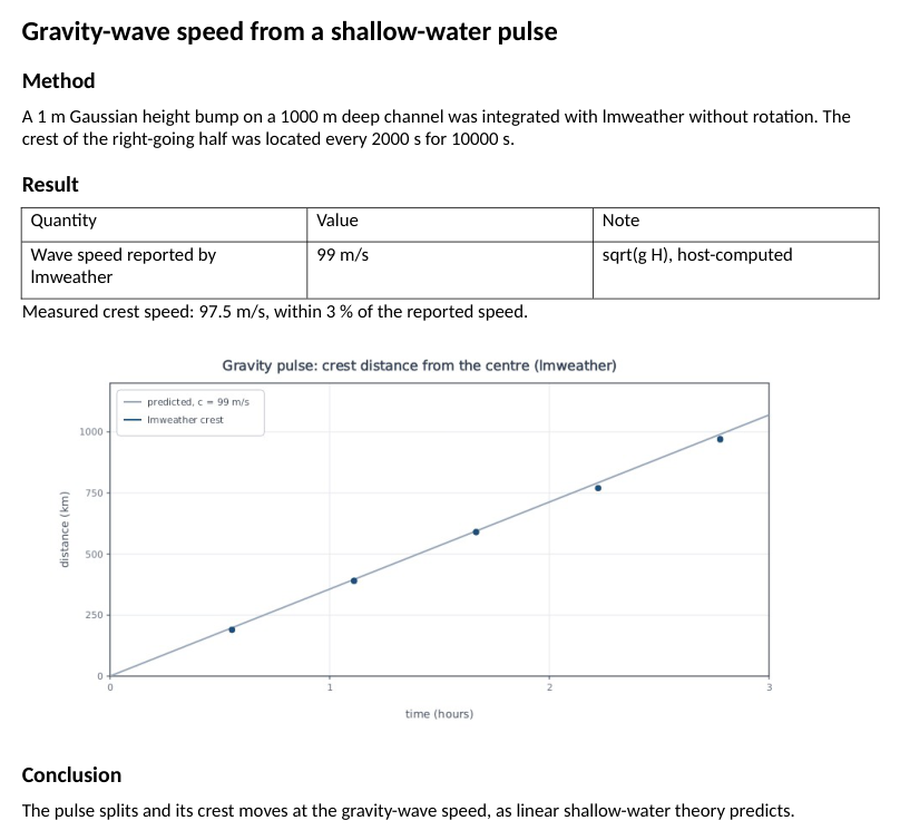</a><br>Gravity-wave speed from a shallow-water pulse | <a href="#cell-growth-lab-report-with-an-lmvideo-figure">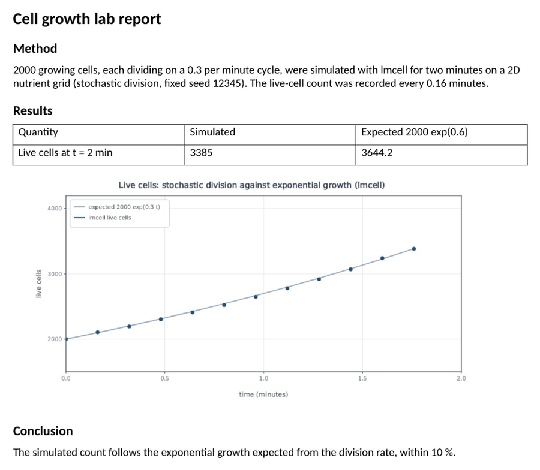</a><br>Cell growth lab report with an lmvideo figure |
| <a href="#physics-lab-report-friction-on-a-ramp-measured-and-checked">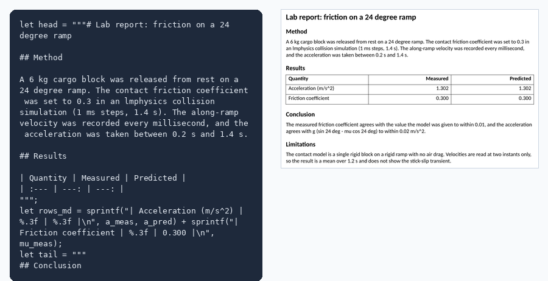</a><br>Physics lab report: friction on a ramp, measured and checked | <a href="#observing-plan-word-and-slides-from-one-markdown-body">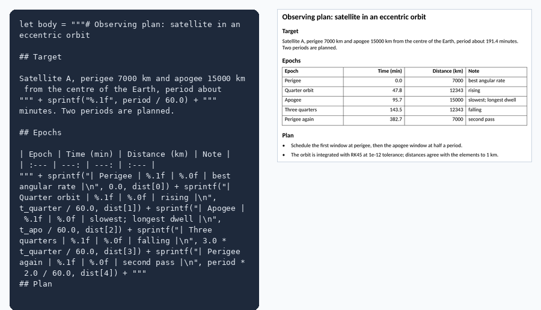</a><br>Observing plan: Word and slides from one Markdown body |
| <a href="#finance-memo-bond-price-duration-and-a-workbook">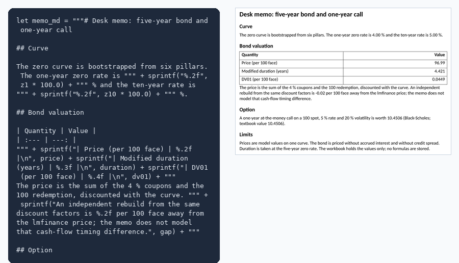</a><br>Finance memo: bond price, duration and a workbook | <a href="#network-audit-report-certificates-and-site-links">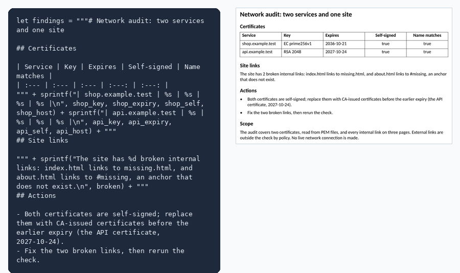</a><br>Network audit report: certificates and site links |
| <a href="#weather-briefing-deck-gravity-wave-speed-by-depth">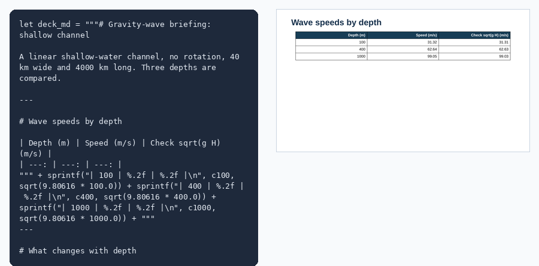</a><br>Weather briefing deck: gravity-wave speed by depth | <a href="#sir-epidemic-results-workbook-and-report">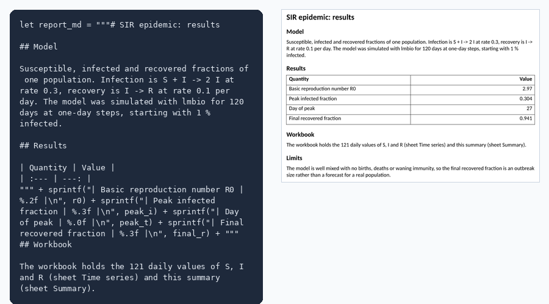</a><br>SIR epidemic: results workbook and report |
| <a href="#infrastructure-change-report-from-applied-state">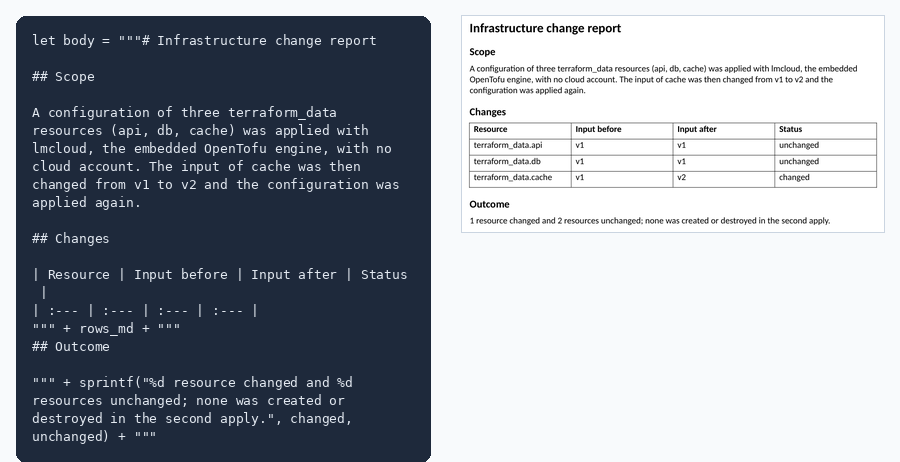</a><br>Infrastructure change report from applied state | <a href="#data-quality-report-from-a-logger-csv">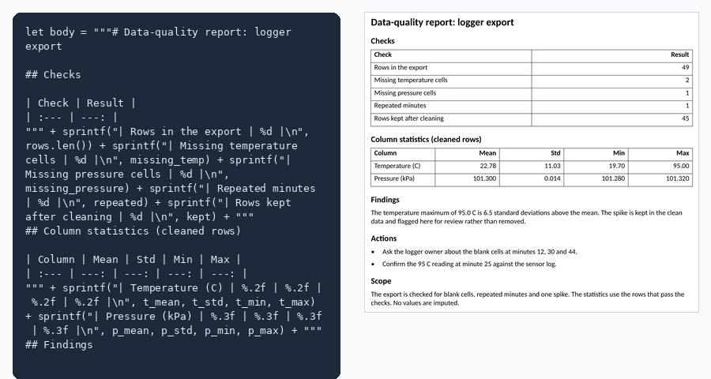</a><br>Data-quality report from a logger CSV |

## Damped oscillator dashboard

lmnum integrates a damped second-order oscillator with CVODE and checks the endpoint against the closed form; lmplot builds a three-panel dashboard from the saved solution: time series against the analytic response, phase portrait, and energy decaying inside its exp(-2 zeta omega t) envelope.

Hosts: lmnum → lmplot. Output: `images/showcase-01-oscillator.png`.

```sh
lmctl https://raw.githubusercontent.com/lmctl-ai/lmgallery/main/examples/01-oscillator-ode-plot.lms
```

## Discounted project cashflows

lmfinance discounts project cashflows continuously at 8%; lmnum reads those computed values and lmvideo draws their amounts, present values and net present value.

Hosts: lmfinance → lmnum → lmvideo. Output: `images/showcase-02-finance-cashflows.png`.

```sh
lmctl https://raw.githubusercontent.com/lmctl-ai/lmgallery/main/examples/02-finance-cashflows-draw.lms
```

## Shallow-water gravity pulse

lmweather evolves a Gaussian shallow-water pulse; lmplot overlays four snapshots and labels the gravity-wave speed.

Hosts: lmweather → lmplot. Output: `images/showcase-03-weather-pulse.png`.

```sh
lmctl https://raw.githubusercontent.com/lmctl-ai/lmgallery/main/examples/03-weather-pulse-plot.lms
```

## Hohmann transfer: equal-time markers

lmspace propagates a Hohmann transfer from a 7000 km orbit to geostationary radius; lmcad renders the sampled trajectory as a tube between the departure and arrival rings, with markers at equal time intervals that bunch up near apogee where the spacecraft is slowest.

Hosts: lmspace → lmcad. Output: `images/showcase-04-space-orbit-cad.png`.

```sh
lmctl https://raw.githubusercontent.com/lmctl-ai/lmgallery/main/examples/04-space-orbit-cad.lms
```

## Cargo-ramp force balance

lmphysics measures acceleration of a six-kilogram cargo block on a 24-degree ramp; lmvideo draws the force balance with correctly oriented, consistently scaled vectors.

Hosts: lmphysics → lmvideo. Output: `images/showcase-05-physics-free-body.png`.

```sh
lmctl https://raw.githubusercontent.com/lmctl-ai/lmgallery/main/examples/05-physics-free-body.lms
```

## Finite-element Poisson field

lmfluid solves a manufactured Poisson problem and lmplot renders the sampled field with a color ramp.

Hosts: lmfluid → lmplot. Output: `images/showcase-06-fluid-poisson-plot.png`.

```sh
lmctl https://raw.githubusercontent.com/lmctl-ai/lmgallery/main/examples/06-fluid-poisson-plot.lms
```

## Michaelis-Menten from mechanism

lmbio integrates the elementary reactions E + S <-> ES -> E + P at ten substrate levels and measures the quasi-steady rate of each run; lmplot shows those rates falling on the hyperbola Vmax S / (Km + S) with Km = (koff + kcat) / kon and Vmax = kcat E0, constants the mechanism never states.

Hosts: lmbio → lmplot. Output: `images/showcase-07-enzyme-response.png`.

```sh
lmctl https://raw.githubusercontent.com/lmctl-ai/lmgallery/main/examples/07-enzyme-response.lms
```

## Cell growth and motility

lmcell evolves two motile populations with different cycle and death rates; lmplot compares their computed final positions and total living-cell count over time.

Hosts: lmcell → lmplot. Output: `images/showcase-08-cell-pattern.png`.

```sh
lmctl https://raw.githubusercontent.com/lmctl-ai/lmgallery/main/examples/08-cell-pattern.lms
```

## Photon attenuation and build-up in water

lmparticle runs seeded Monte Carlo histories of 662 keV photons through six water slabs and counts uncollided photons and all forward crossings; lmplot compares the uncollided fraction with exp(-mu x) on a log axis and shows the scattered build-up above it.

Hosts: lmparticle → lmplot. Output: `images/showcase-09-photon-transport.png`.

```sh
lmctl https://raw.githubusercontent.com/lmctl-ai/lmgallery/main/examples/09-photon-transport.lms
```

## Water dimer: hydrogen bond in 3D

lmmolecule minimizes two flexible TIP3P molecules into the hydrogen-bonded dimer (about -6.5 kcal/mol at R(O-O) = 2.74 A) and scans the acceptor along the O-O axis; lmcad renders the minimized coordinates as ball-and-stick with the hydrogen bond as a cyan rod; lmplot places that render beside the energy curve.

Hosts: lmmolecule → lmcad → lmplot. Output: `images/showcase-10-molecule-dimer-cad.png`.

```sh
lmctl https://raw.githubusercontent.com/lmctl-ai/lmgallery/main/examples/10-molecule-dimer-cad.lms
```

## Shielding by mass: lead, aluminum, water

lmparticle transports 662 keV photons through lead, aluminum and water slabs of equal mass per area; lmvideo draws the three layouts to scale; lmplot combines that layout with the measured transmission curves, showing that per gram lead is only modestly better where Compton scattering dominates.

Hosts: lmparticle → lmvideo → lmplot. Output: `images/showcase-11-particle-shield-layout.png`.

```sh
lmctl https://raw.githubusercontent.com/lmctl-ai/lmgallery/main/examples/11-particle-shield-layout.lms
```

## Geostrophic adjustment, animated

lmweather releases a 600 km Gaussian height bump at rest on an f-plane: inertia-gravity waves radiate at sqrt(gH) while a weaker balanced bump set by the Rossby radius stays behind, with potential vorticity conserved; lmplot renders a frame every 30 minutes and ffmpeg assembles the 14-hour animation.

Hosts: lmweather → lmplot. Output: `images/showcase-12-weather-adjustment.gif`.

```sh
lmctl https://raw.githubusercontent.com/lmctl-ai/lmgallery/main/examples/12-weather-adjustment-gif.lms
```

## Dosing regimen inside a therapeutic window

lmbio integrates a one-compartment oral model for 800 mg a day given as 400 mg every 12 h or 800 mg daily, restarting at each dose; both share the asserted average level 7.2 mg/L but only the twice-daily regimen stays inside 3-12 mg/L. lmvideo draws the compartment model; lmplot overlays window, average and both profiles.

Hosts: lmbio → lmvideo → lmplot. Output: `images/showcase-13-bio-dosing-regimen.png`.

```sh
lmctl https://raw.githubusercontent.com/lmctl-ai/lmgallery/main/examples/13-bio-dosing-regimen.lms
```

## Damping-ratio sweep as a contact sheet

lmnum integrates the unit-step response of a second-order system for six damping ratios and checks each overshoot against exp(-pi zeta / sqrt(1 - zeta^2)); lmplot draws one panel per case; lmvideo assembles the panels into a labelled report sheet with a header band.

Hosts: lmnum → lmplot → lmvideo. Output: `images/showcase-14-num-sweep-contact-sheet.png`.

```sh
lmctl https://raw.githubusercontent.com/lmctl-ai/lmgallery/main/examples/14-num-sweep-contact-sheet.lms
```

## Equalizer: designed versus measured

lmaudio designs a three-band equalizer as biquads (low shelf, presence peak, high shelf), measures the whole chain by passing a unit impulse through it, and sends a plucked string through the same chain; lmplot overlays the designed band responses with the measured chain and the dry and equalized string spectra.

Hosts: lmaudio → lmplot. Output: `images/showcase-15-audio-eq-measurement.png`.

```sh
lmctl https://raw.githubusercontent.com/lmctl-ai/lmgallery/main/examples/15-audio-eq-measurement.lms
```

## Kepler orbit energy check

lmspace propagates an eccentric orbit (perigee 7000 km, apogee 15000 km) for two periods with RK45 at 1e-12 tolerance; lmplot draws the path, the radius against time and the relative energy error, whose largest excursion is about 2e-12, a measured integrator noise floor.

Hosts: lmspace → lmplot. Output: `images/showcase-16-kepler-conservation.png`.

```sh
lmctl https://raw.githubusercontent.com/lmctl-ai/lmgallery/main/examples/16-kepler-conservation.lms
```

## Driven oscillator: transient to steady state

lmnum integrates a damped oscillator driven near resonance from rest, with the forcing carried as a third ODE state, and checks the late-time amplitude against the closed form; lmplot draws the beating transient settling onto the steady amplitude and the (x, v) phase portrait.

Hosts: lmnum → lmplot. Output: `images/showcase-17-oscillator-driven.png`.

```sh
lmctl https://raw.githubusercontent.com/lmctl-ai/lmgallery/main/examples/17-oscillator-driven-transient.lms
```

## Intermediate-axis tumble of a free plate

lmphysics spins a free plate at 10 rad/s about its intermediate principal axis, nudged by 0.01 rad/s; the recorded body angular velocity shows the tennis-racket instability growing into tumbles every 3 s, while kinetic energy and angular momentum drift below 1e-5. The composition is drawn in lmplot, and the same flip appears in the lmphysics tennis_racket example.

Hosts: lmphysics → lmplot. Output: `images/showcase-18-rigid-body-intermediate-axis.png`.

```sh
lmctl https://raw.githubusercontent.com/lmctl-ai/lmgallery/main/examples/18-rigid-body-intermediate-axis.lms
```

## Finite-element error against a known answer

lmfluid solves a Poisson problem on an 8 x 8 mesh with linear and quadratic elements for a quadratic exact solution; the quadratic elements reproduce it to solver tolerance while the linear error map shows the element pattern. lmplot draws both |error| maps on one colour scale.

Hosts: lmfluid → lmplot. Output: `images/showcase-19-fem-poisson-error.png`.

```sh
lmctl https://raw.githubusercontent.com/lmctl-ai/lmgallery/main/examples/19-fem-poisson-error.lms
```

## Heat conduction in x and t

lmnum integrates one-dimensional heat conduction by the method of lines with its stiff solver and checks the result against the exact exponential decay; lmplot draws the x-t spacetime heat map and the profiles at three times against the exact curves.

Hosts: lmnum → lmplot. Output: `images/showcase-20-heat-spacetime.png`.

```sh
lmctl https://raw.githubusercontent.com/lmctl-ai/lmgallery/main/examples/20-heat-spacetime.lms
```

## Forecast with a 95 % prediction band

lmnum fits a trend with annual harmonics to 60 months of demand by least squares, computes the residual deviation and the 95 % prediction interval of each of 12 future months from the design matrix, and checks that the true future values fall inside the band; lmplot draws the history, the fit, the forecast and its widening band.

Hosts: lmnum → lmplot. Output: `images/showcase-21-forecast-band.png`.

```sh
lmctl https://raw.githubusercontent.com/lmctl-ai/lmgallery/main/examples/21-forecast-prediction-band.lms
```

## Seasonal decomposition by least squares

lmnum fits a quadratic trend with annual and semi-annual harmonics to eight years of monthly data in one least-squares solve, and recovers the 10-unit annual amplitude and the 2.5 residual deviation within stated tolerances; lmplot draws observed, trend, seasonal and residual panels on a shared time axis.

Hosts: lmnum → lmplot. Output: `images/showcase-22-seasonal-decomposition.png`.

```sh
lmctl https://raw.githubusercontent.com/lmctl-ai/lmgallery/main/examples/22-seasonal-decomposition.lms
```

## Regression diagnostics: predicted, actual and residuals

lmnum fits a linear model to 120 observations that contain a quadratic term it does not include, with R^2 and RMSE from the least-squares solve; the predicted-against-actual and residuals-against-predicted panels show the misfit as a curve in the residuals.

Hosts: lmnum → lmplot. Output: `images/showcase-23-regression-residuals.png`.

```sh
lmctl https://raw.githubusercontent.com/lmctl-ai/lmgallery/main/examples/23-regression-residuals.lms
```

## Daily sign-ups on a date axis

lmnum generates a seeded year of daily sign-ups with a trend and a weekend effect, builds the trailing 7-day mean and checks that weekends fall about 12 below weekdays; lmplot draws the daily counts and the mean on a real date axis, with the start date converted by gnuplot strptime.

Hosts: lmnum → lmplot. Output: `images/showcase-24-signups-date-axis.png`.

```sh
lmctl https://raw.githubusercontent.com/lmctl-ai/lmgallery/main/examples/24-signups-date-axis.lms
```

## Call-centre queue over one day

lmnum evaluates the M/M/c Erlang-C formula for eight agents at each hour of a day with a peak arrival rate of 70 calls per hour, after checking the textbook value C(2, 1) = 1/3; lmplot draws the busy agents on the right axis and the mean queue length on the left.

Hosts: lmnum → lmplot. Output: `images/showcase-25-queue-erlang-c.png`.

```sh
lmctl https://raw.githubusercontent.com/lmctl-ai/lmgallery/main/examples/25-queue-erlang-c.lms
```

## Quarterly business review deck with lmvideo charts

lmvideo draws three Skia charts (quarterly revenue, operating margin, regional mix) from one set of figures; lmoffice places them on the slides of a six-slide Open XML deck with highlights, bullets and notes. The picture is a LibreOffice render of the finished deck.

Hosts: lmvideo → lmoffice. Output: `images/showcase-26-qbr-deck.png`.

```sh
lmctl https://raw.githubusercontent.com/lmctl-ai/lmgallery/main/examples/26-qbr-deck-charts.lms
```

## Sales report with a chart per section

lmvideo draws three Skia charts (revenue by region, by product line, and the monthly trend); lmoffice builds a Word report with a heading, text, chart and figure table for each section. The script checks that regions and products each add up to the Q3 total. The picture is a LibreOffice render of the document.

Hosts: lmvideo → lmoffice. Output: `images/showcase-27-sales-report.png`.

```sh
lmctl https://raw.githubusercontent.com/lmctl-ai/lmgallery/main/examples/27-sales-report-docx.lms
```

## Forecast workbook with a native chart

lmnum fits a linear trend to 24 months of sales by least squares and checks the slope and residual deviation; lmvideo draws the forecast with its 95 % band as a PNG; lmoffice writes an Excel workbook with the forecast table, variance formulas and a native bar chart beside it. The picture is a LibreOffice render of the workbook.

Hosts: lmnum → lmvideo → lmoffice. Output: `images/showcase-28-forecast-workbook.png`.

```sh
lmctl https://raw.githubusercontent.com/lmctl-ai/lmgallery/main/examples/28-forecast-workbook-chart.lms
```

## Invoice with a generated logo and payment glyph

lmvideo draws a logo and a deterministic 21 x 21 QR-like glyph as PNG images; lmoffice places them in a Word invoice with a line-item table, tax and totals. The glyph is decorative and not a scannable code. The script checks the subtotal, tax and total. The picture is a LibreOffice render of the invoice.

Hosts: lmvideo → lmoffice. Output: `images/showcase-29-invoice-logo.png`.

```sh
lmctl https://raw.githubusercontent.com/lmctl-ai/lmgallery/main/examples/29-invoice-logo-glyph.lms
```

## Resume with a skills bar chart

lmvideo draws six horizontal skill bars with their levels on a Skia canvas as a PNG; lmoffice places the chart in a Word resume with a summary, experience and education. The picture is a LibreOffice render of the resume.

Hosts: lmvideo → lmoffice. Output: `images/showcase-30-resume-skills.png`.

```sh
lmctl https://raw.githubusercontent.com/lmctl-ai/lmgallery/main/examples/30-resume-skills-bars.lms
```

## Science report: damping recovered from simulated peaks

lmnum integrates a damped oscillator at three damping ratios with CVODE, refines the peaks, and estimates each damping ratio from the logarithmic decrement, asserting 1 % agreement; lmvideo plots measured against set damping with the identity line; lmoffice writes the report with a method section, a results table, the figure and a conclusion. The picture is a LibreOffice render of the report.

Hosts: lmnum → lmvideo → lmoffice. Output: `images/showcase-31-science-report.png`.

```sh
lmctl https://raw.githubusercontent.com/lmctl-ai/lmgallery/main/examples/31-science-report-damping.lms
```

## Annual revenue bars with currency ticks

lmnum builds 11 years of revenue from a seeded 17 % compound growth model with 2 % noise and recovers the growth rate by a least-squares fit of the logarithm, asserting it within 0.01; lmplot draws the bars with native $0B to $300B axis ticks and a value label on each bar.

Hosts: lmnum → lmplot. Output: `images/showcase-32-revenue-bars.png`.

```sh
lmctl https://raw.githubusercontent.com/lmctl-ai/lmgallery/main/examples/32-revenue-bars-currency.lms
```

## Standing waves on a membrane, animated

lmnum discretizes the Laplacian of a square membrane, takes its eigenvalues and checks the lowest and the twice-degenerate second against the closed form; the mode frequencies drive an lmvideo animation of two superposed standing-wave modes over one period, encoded to MP4 with ffmpeg. The picture is the in-phase first frame.

Hosts: lmnum → lmvideo. Output: `images/showcase-33-wave-2d.png`.

```sh
lmctl https://raw.githubusercontent.com/lmctl-ai/lmgallery/main/examples/33-wave-2d-animation.lms
```

## Image pipeline with a before/after contact sheet

lmvideo builds a procedural landscape, runs levels, unsharp and colour-curve steps, measures SSIM and PSNR against the original, and writes a three-panel contact sheet; lmoffice places the sheet on an Open XML slide with the measured values as bullets. The picture is a LibreOffice render of the slide.

Hosts: lmvideo → lmoffice. Output: `images/showcase-34-image-pipeline.png`.

```sh
lmctl https://raw.githubusercontent.com/lmctl-ai/lmgallery/main/examples/34-image-pipeline-contact-sheet.lms
```

## Rates and options desk pack: curve, option table and memo

lmfinance bootstraps a six-pillar zero-rate curve and prices a one-year at-the-money call at five spot levels, checking the textbook value 10.4506; lmvideo draws the curve as a PNG; lmoffice writes an Excel workbook with stored discount-factor and payoff formulas and native line and bar charts, and a Word memo that quotes the same numbers. The picture is a LibreOffice render of the workbook.

Hosts: lmfinance → lmvideo → lmoffice. Output: `images/showcase-35-rates-options.png`.

```sh
lmctl https://raw.githubusercontent.com/lmctl-ai/lmgallery/main/examples/35-finance-curve-option-workbook.lms
```

## HTML link-check report with a terminal picture

lmhtml loads a three-page site, checks every internal link and writes a report that the program reads back and asserts; lmvideo draws the run as a terminal-style PNG using the report lines; lmoffice writes the Word report with the broken-link table and the picture. The external link is left unchecked by policy.

Hosts: lmhtml → lmvideo → lmoffice. Output: `images/showcase-36-link-check.png`.

```sh
lmctl https://raw.githubusercontent.com/lmctl-ai/lmgallery/main/examples/36-html-link-check-report.lms
```

## Certificate inventory from lmssl

lmssl parses two service certificates (fixed test certificates inlined in the script) and reports subject, key type, expiry, SHA-256 fingerprint and self-signed status, asserted by the program; lmvideo draws a card view as a PNG; lmoffice writes the Word inventory with a table, the cards and the renewal action. The picture is a LibreOffice render of the document.

Hosts: lmssl → lmvideo → lmoffice. Output: `images/showcase-37-cert-inventory.png`.

```sh
lmctl https://raw.githubusercontent.com/lmctl-ai/lmgallery/main/examples/37-cert-inventory-docx.lms
```

## Product slide with an lmvideo 3D render

lmvideo builds a sensor housing from primitives (box body, teal cap, lens, mounting rings), lights it and renders a 900 x 540 PNG; lmoffice places the render on a product slide with the specification bullets and speaker notes. The picture is a LibreOffice render of the slide.

Hosts: lmvideo → lmoffice. Output: `images/showcase-38-product-render.png`.

```sh
lmctl https://raw.githubusercontent.com/lmctl-ai/lmgallery/main/examples/38-product-render-slide.lms
```

## Audio harmonics slide with a WAV file

lmaudio synthesises a 220 Hz sawtooth, saves it as a WAV file, and measures its spectrum (peak frequency and the first eight harmonic amplitudes), asserting the fundamental and the 1/k fall-off; lmvideo draws the harmonic amplitudes as a PNG; lmoffice places the chart on a slide with the measured values and the WAV file name in the speaker notes. The picture is a LibreOffice render of the slide.

Hosts: lmaudio → lmvideo → lmoffice. Output: `images/showcase-39-audio-harmonics.png`.

```sh
lmctl https://raw.githubusercontent.com/lmctl-ai/lmgallery/main/examples/39-audio-harmonics-slide.lms
```

## Predator-prey lab report with an lmvideo figure

lmbio builds the coupled prey and predator model from its mass-action reactions, simulates it for 20 time units, and reports the peaks and final populations, asserting positive populations and predators peaking after prey; lmvideo draws the trajectories from twelve samples as a PNG; lmoffice writes the Word lab report with the method, results table, figure and conclusion. The picture is a LibreOffice render of the report.

Hosts: lmbio → lmvideo → lmoffice. Output: `images/showcase-40-predator-prey.png`.

```sh
lmctl https://raw.githubusercontent.com/lmctl-ai/lmgallery/main/examples/40-bio-predator-prey-report.lms
```

## Gravity-wave speed from a shallow-water pulse

lmweather releases a 1 m Gaussian pulse on a 1000 m deep channel and tracks the crest of the right-going half every 2000 s; the program checks the measured speed against the wave speed the host reports, sqrt(gH), within 3 %. lmvideo plots the crest distance with the predicted line as a PNG; lmoffice writes the report with the result and the figure. The picture is a LibreOffice render of the report.

Hosts: lmweather → lmvideo → lmoffice. Output: `images/showcase-41-gravity-wave-speed.png`.

```sh
lmctl https://raw.githubusercontent.com/lmctl-ai/lmgallery/main/examples/41-weather-gravity-wave-speed.lms
```

## Cell growth lab report with an lmvideo figure

lmcell seeds 2000 dividing cells on a 2D nutrient grid and records the live-cell count over two minutes; the program checks the final count against the exponential 2000 exp(0.6) within 10 %. lmvideo plots the counts against the expected curve as a PNG; lmoffice writes the Word lab report with the method, a results table, the figure and a conclusion. The picture is a LibreOffice render of the report.

Hosts: lmcell → lmvideo → lmoffice. Output: `images/showcase-42-cell-growth.png`.

```sh
lmctl https://raw.githubusercontent.com/lmctl-ai/lmgallery/main/examples/42-cell-growth-report.lms
```

## Physics lab report: friction on a ramp, measured and checked

lmphysics runs a 6 kg block on a 24 degree ramp with friction 0.3 and records its velocity; the script measures the acceleration and the friction coefficient, asserts both, and formats the results as Markdown. lmoffice writes the Word lab report with a heredoc limitations section; lmvideo draws measured against predicted acceleration. The picture shows the source next to the rendered page.

Hosts: lmphysics → lmoffice → lmpdf → lmvideo. Output: `images/showcase-43-physics-lab.png`.

```sh
lmctl https://raw.githubusercontent.com/lmctl-ai/lmgallery/main/examples/43-physics-lab-report.lms
```

## Observing plan: Word and slides from one Markdown body

lmspace propagates a satellite in an eccentric orbit for two periods; the script reads five epochs from the state history, checks the perigee and apogee distances against the elements, and formats the plan as Markdown. lmoffice writes the plan as a Word document and as a slide deck; lmvideo draws the distance at each epoch. The picture shows the source next to the rendered Word page.

Hosts: lmspace → lmoffice → lmpdf → lmvideo. Output: `images/showcase-44-observing-plan.png`.

```sh
lmctl https://raw.githubusercontent.com/lmctl-ai/lmgallery/main/examples/44-astronomy-observing-plan.lms
```

## Finance memo: bond price, duration and a workbook

lmfinance bootstraps a zero curve, prices a 5-year 4 % bond and a one-year call, and reports the duration and DV01. The script checks the bond against the discount factors and the call against 10.4506; lmoffice writes the Word memo (with a heredoc limitations section) and an Excel workbook with the curve and the cash flows; lmvideo draws the zero rates. The picture shows the source next to the rendered memo.

Hosts: lmfinance → lmoffice → lmpdf → lmvideo. Output: `images/showcase-45-finance-bond-memo.png`.

```sh
lmctl https://raw.githubusercontent.com/lmctl-ai/lmgallery/main/examples/45-finance-bond-memo.lms
```

## Network audit report: certificates and site links

lmssl parses two service certificates (key, expiry, self-signed status, name match) and lmhtml checks every internal link of a three-page site; the script asserts the findings it expects, formats them as Markdown, and lmoffice writes the audit as a Word report. lmvideo draws the check counts. The picture shows the source next to the rendered audit.

Hosts: lmssl → lmhtml → lmoffice → lmpdf → lmvideo. Output: `images/showcase-46-network-audit.png`.

```sh
lmctl https://raw.githubusercontent.com/lmctl-ai/lmgallery/main/examples/46-network-audit-report.lms
```

## Weather briefing deck: gravity-wave speed by depth

lmweather computes the gravity-wave speed of a shallow channel at 100, 400 and 1000 m and checks each against sqrt(g H); the script formats the briefing as Markdown slides with a table and a chart, and lmoffice writes the deck. lmvideo draws the speeds. The picture shows the source next to the rendered table slide.

Hosts: lmweather → lmoffice → lmvideo. Output: `images/showcase-47-weather-briefing.png`.

```sh
lmctl https://raw.githubusercontent.com/lmctl-ai/lmgallery/main/examples/47-weather-briefing-slides.lms
```

## SIR epidemic: results workbook and report

lmbio simulates an SIR epidemic from mass-action reactions for 120 days, checks that the population is conserved, and asserts the peak and final sizes against R0 = 2.97. The daily series goes to an Excel workbook with typed values, the summary to a Word report, and lmvideo draws the compartments. The picture shows the source next to the rendered report.

Hosts: lmbio → lmoffice → lmvideo. Output: `images/showcase-48-sir-epidemic.png`.

```sh
lmctl https://raw.githubusercontent.com/lmctl-ai/lmgallery/main/examples/48-bio-epidemic-workbook.lms
```

## Infrastructure change report from applied state

lmcloud runs OpenTofu in-process on three terraform_data resources, applies them, changes one input and applies again. The script reads both Terraform states back with json_parse, compares them resource by resource, and asserts one change and two unchanged resources. lmoffice writes the change table as a Word report; lmvideo draws the outcomes. The picture shows the source next to the rendered report.

Hosts: lmcloud → lmoffice → lmpdf → lmvideo. Output: `images/showcase-49-cloud-plan.png`.

```sh
lmctl https://raw.githubusercontent.com/lmctl-ai/lmgallery/main/examples/49-cloud-plan-report.lms
```

## Data-quality report from a logger CSV

The script generates a 48-minute logger export with planted defects (blank cells, a repeated minute, a spike) and checks it with csv_parse. lmnum loads the cleaned table, computes the column statistics and the z-score of the spike, and lmoffice writes the report as a Word document. lmvideo draws the issue counts. The picture shows the source next to the rendered report.

Hosts: lmnum → lmoffice → lmpdf → lmvideo. Output: `images/showcase-50-data-quality.png`.

```sh
lmctl https://raw.githubusercontent.com/lmctl-ai/lmgallery/main/examples/50-data-quality-report.lms
```
